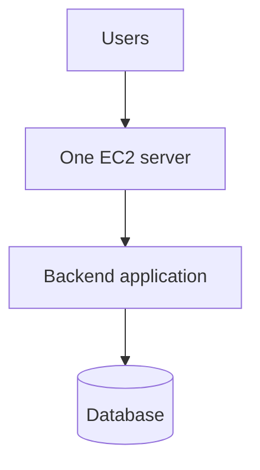
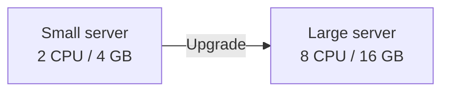
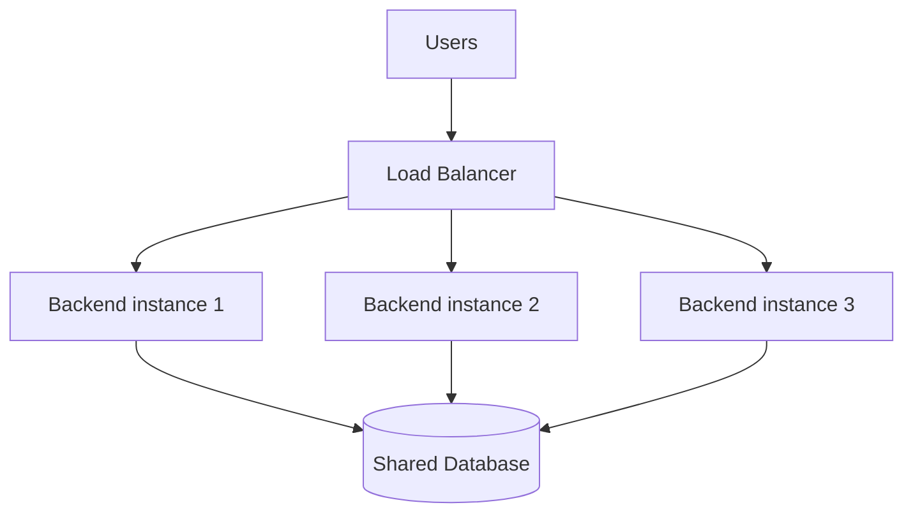
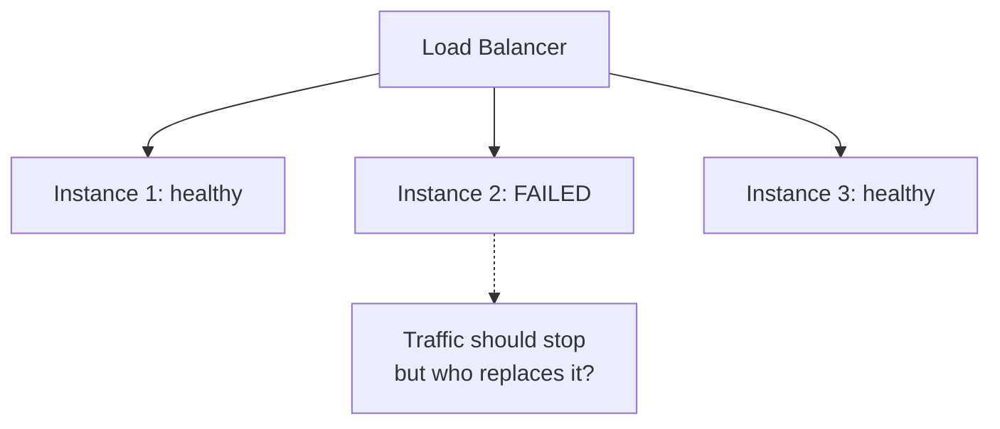
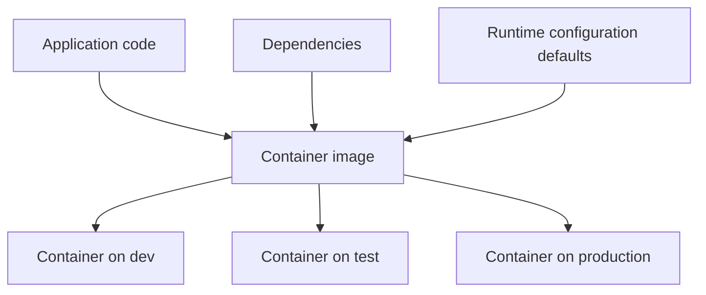
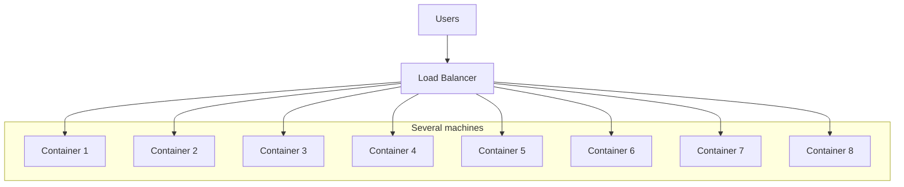
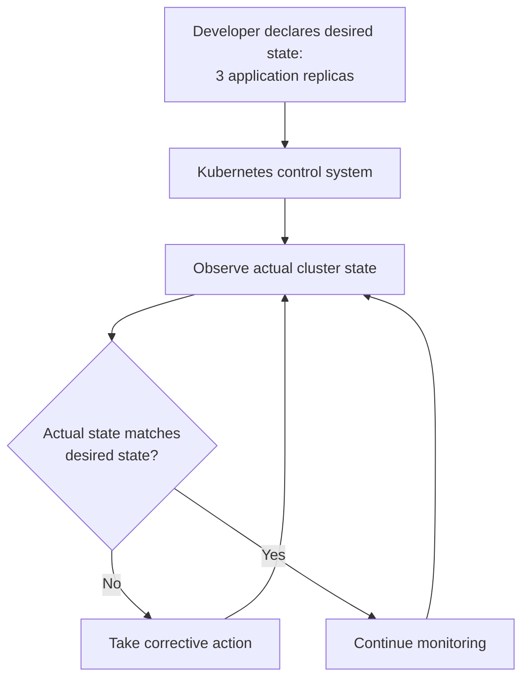
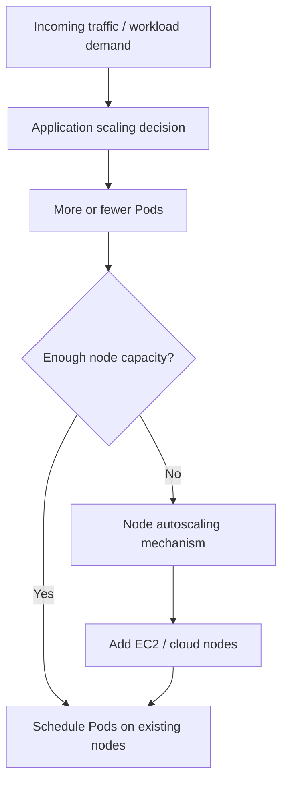
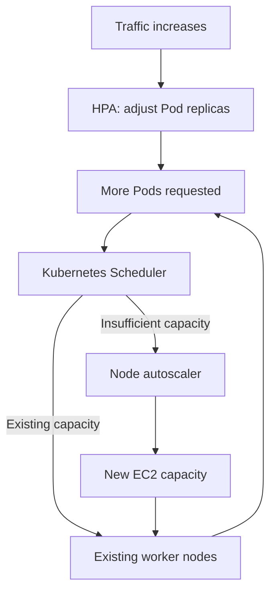
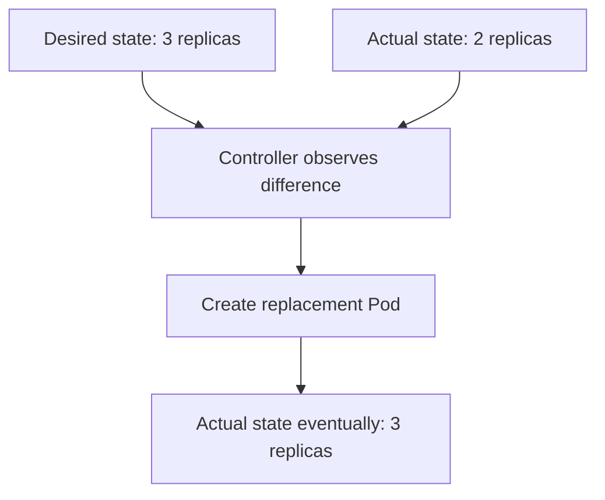

# Chapter 00: Kubernetes কেন দরকার?

> এই অধ্যায়ের লক্ষ্য Kubernetes-এর command বা YAML শেখা নয়। লক্ষ্য হলো এমন সমস্যাগুলো বোঝা, যেগুলো Kubernetes-এর মতো একটি platform-এর প্রয়োজন তৈরি করেছে।

[← Tutorial home](../../README.md)

## এই অধ্যায়ে কী শিখবে

এই chapter শেষে তুমি:

- বুঝতে পারবে একটি application deploy করে চালু রাখা কেন ধীরে ধীরে কঠিন হয়ে ওঠে।
- Server, process, container, replica এবং infrastructure-এর সম্পর্ক বুঝবে।
- Scaling-এর বিভিন্ন ধরন আলাদা করতে পারবে।
- AWS Auto Scaling Group (ASG) কী করে এবং Kubernetes তার থেকে আলাদা কোন সমস্যার সমাধান করে তা ব্যাখ্যা করতে পারবে।
- বুঝবে Kubernetes শুধু scaling tool নয়; এটি application-এর desired state বজায় রাখার একটি control system।
- পরের chapter-গুলোর জন্য প্রয়োজনীয় mental model তৈরি করবে।

---

## 1. গল্পটা শুরু করি: একটা application, একটা server

ধরো, তুমি একটা web application বানালে। Backend-এ একটি API server, database, আর frontend আছে। প্রথম দিকে traffic খুব কম। একটি EC2 instance-এ backend চালিয়ে দিলেই কাজ হচ্ছে।

প্রথমে সবকিছু সহজ:

- Server চালু আছে।
- Application process চলছে।
- User request আসছে, application response দিচ্ছে।
- Server-এ SSH করে log দেখা যায়।
- নতুন version deploy করতে process restart করা যায়।

কিন্তু application জনপ্রিয় হতে শুরু করলে, এই সরল setup-এ ফাটল দেখা দেয়।

## 2. Traffic বাড়লে কী কী সমস্যা হয়?

### সমস্যা ১: Server-এর capacity শেষ

ধরো server একসাথে 500টি request ভালোভাবে handle করতে পারে। হঠাৎ 2,000 user request পাঠালে CPU, memory, connection pool বা অন্য কোনো resource bottleneck হতে পারে। Request ধীর হয়ে যায়, timeout হয়, কখনো application crash-ও করতে পারে।

প্রথম সমাধান হতে পারে বড় server নেওয়া। এটাকে সাধারণভাবে **vertical scaling** বা scale up বলা হয়।

বড় server কিছুদিন সাহায্য করতে পারে। কিন্তু এর সীমা আছে:

- বড় machine-এর দাম দ্রুত বাড়তে পারে।
- Machine-এর সর্বোচ্চ capacity-র সীমা আছে।
- এক machine-এ সব থাকলে machine failure একটি বড় outage তৈরি করতে পারে।
- Capacity বাড়ালেও application-এর একটিমাত্র instance-ই থাকলে application-level failure-এর ঝুঁকি থেকেই যায়।

### সমস্যা ২: একাধিক application instance চালাতে হবে

একটি server-এর বদলে একই application-এর কয়েকটি instance চালানো যায়। একে **horizontal scaling** বা scale out বলে।

এতে request বিভিন্ন instance-এ ভাগ করা যায়। কিন্তু নতুন প্রশ্ন তৈরি হয়:

- কোন instance-এ request পাঠাব?
- একটি instance মারা গেলে traffic কীভাবে বন্ধ করব?
- Instance-টি আবার কীভাবে চালু করব?
- কতগুলো instance দরকার?
- Traffic কমলে instance কমাব কীভাবে?
- নতুন version deploy করলে সব instance একসাথে restart না করে কীভাবে update করব?

Load balancer traffic ভাগ করতে পারে, কিন্তু application instance তৈরি করা, সেগুলোর health বজায় রাখা, update করা এবং capacity অনুযায়ী সংখ্যা পরিবর্তন করার পুরো দায়িত্ব একা load balancer-এর নয়।

### সমস্যা ৩: Instance মারা গেলে?

তিনটি instance চলছে। একটি process crash করল বা machine নষ্ট হলো।

Load balancer হয়তো unhealthy instance-এ traffic পাঠানো বন্ধ করবে। কিন্তু traffic বন্ধ করা আর replacement instance তৈরি করা এক কাজ নয়।

কেউ বা কোনো system-কে জানতে হবে:

1. Desired instance count কত?
2. বর্তমানে healthy instance কতটি?
3. একটি কম থাকলে replacement কোথায় তৈরি হবে?
4. নতুন instance ready হয়েছে কিনা?
5. Ready না হওয়া পর্যন্ত user traffic কীভাবে এড়াবে?

এই দায়িত্বগুলো হাতে সামলানো দ্রুত জটিল হয়ে ওঠে।

---

## 3. Containers আমাদের কী সাহায্য করল?

Application deploy করার আগে dependency, runtime, configuration এবং environment নিয়ে সমস্যা হয়। একটি machine-এ কাজ করা application অন্য machine-এ গিয়ে ভিন্ন version-এর library বা runtime পেয়ে ভেঙে যেতে পারে।

Container image application ও তার প্রয়োজনীয় runtime/dependencies-কে একটি repeatable package-এ সাজায়।

Container আমাদের সাহায্য করে:

- একই image বিভিন্ন environment-এ চালাতে।
- Application release-কে version করতে।
- Deployment-এর সময় dependency install করার অনিশ্চয়তা কমাতে।
- Application-কে infrastructure থেকে কিছুটা বিচ্ছিন্ন করতে।

কিন্তু গুরুত্বপূর্ণ কথা:

> **Container application-কে package করে এবং চালাতে সাহায্য করে। Container fleet পরিচালনা করার সম্পূর্ণ সমাধান এটি নিজে নয়।**

আমরা এখন একটি application-এর container image তৈরি করতে পারি। কিন্তু production-এ 20টি container চালাতে হলে সেগুলো কোথায় চলবে, কীভাবে health monitor হবে, কীভাবে traffic পাবে, failure হলে replacement হবে কিনা, এবং load অনুযায়ী সংখ্যা বাড়বে/কমবে কিনা, এসব প্রশ্নের উত্তর এখনও দরকার।

---

## 4. Container বাড়লে নতুন সমস্যা: Operations

ধরো, application-এর 8টি replica চলছে, 4টি server-এ ভাগ করা।

Container-গুলো চালানো সম্ভব, কিন্তু পরিচালনার কাজ বাড়ে। একটি operations platform-কে অন্তত এসব প্রশ্নের উত্তর দিতে হয়:

| প্রশ্ন | আমাদের কী দরকার? |
|---|---|
| কোন machine-এ container চালাব? | Placement / scheduling |
| Container crash করলে? | Health detection ও recovery |
| Instance সংখ্যা কীভাবে বজায় রাখব? | Desired-state management |
| নতুন version deploy করব কীভাবে? | Controlled rollout |
| Traffic কোন instance-এ যাবে? | Service discovery ও load balancing |
| CPU/memory সীমা কীভাবে নির্ধারণ করব? | Resource management |
| Application config কোথায় রাখব? | Configuration management |
| Machine-এ জায়গা না থাকলে? | Capacity management |
| Traffic কমলে অতিরিক্ত instance কীভাবে কমাব? | Scale-in |
| Deployment ভুল হলে? | Rollback / recovery |

এগুলো একেকটি feature নয় মাত্র। এগুলো একসঙ্গে কাজ করার মতো একটি management system-এর প্রয়োজন তৈরি করে।

---

## 5. Kubernetes-এর আগে: এগুলো কি নিজে করা যেত না?

অবশ্যই যেত। Kubernetes আসার আগে এবং Kubernetes ছাড়া আজও বিভিন্ন tool, script, cloud service ও platform দিয়ে এই কাজগুলো করা হয়।

নিজস্ব scripts দিয়ে:

- Instance তৈরি করা
- Process/container চালু করা
- Health check করা
- Failure হলে restart করা
- Load balancer update করা
- Deployment script চালানো

Cloud services দিয়ে:

- Virtual machine তৈরি করা
- Instance group পরিচালনা করা
- Load balancing
- Metrics-ভিত্তিক scaling

কিন্তু custom automation-এর একটি সমস্যা হলো, application বড় হওয়ার সাথে সাথে অনেক script, trigger, state, retry, failure handling ও dependency একে অপরের সাথে জড়িয়ে যেতে পারে।

যেমন, একটি script instance তৈরি করল, আরেকটি script load balancer update করল, আরেকটি health check করল। Instance তৈরি হলেও application ready না হলে traffic পাঠানো যাবে না। Script মাঝপথে ব্যর্থ হলে? একই কাজ দুইবার trigger হলে? পুরনো instance সরানোর আগে নতুন instance ready না হলে?

এসব সমস্যা সমাধান সম্ভব, কিন্তু একটি consistent system তৈরি ও maintain করার খরচ বাড়তে থাকে।

Kubernetes এই management problem-কে একটি সাধারণ API, desired state এবং continuously running control processes-এর মাধ্যমে সমাধানের চেষ্টা করে।

---

## 6. Kubernetes আসলে কী করে?

Kubernetes একটি open-source platform, যা containerized application deploy, manage, scale এবং তাদের desired state বজায় রাখতে সাহায্য করে।

Kubernetes-কে শুধু “container চালানোর tool” হিসেবে ভাবলে এর মূল ধারণাটি মিস হবে।

তুমি Kubernetes-কে বলতে পারো:

> “আমার application-এর 3টি replica চলতে থাকা দরকার।”

Kubernetes-এর বিভিন্ন component মিলে চেষ্টা করে এই চাওয়াকে বাস্তব অবস্থার সঙ্গে মিলিয়ে রাখতে।

এই loop-টি খুব গুরুত্বপূর্ণ। Kubernetes একবার command চালিয়ে চলে যায় না। Cluster-এর অবস্থা পর্যবেক্ষণ করে এবং প্রয়োজন হলে desired state-এর দিকে ফেরানোর চেষ্টা করে।

উদাহরণ:

- তুমি 3টি replica চাও।
- বর্তমানে 3টি চলছে।
- একটি Pod/instance নষ্ট হয়ে 2টি থাকে।
- Kubernetes-এর workload controller বুঝতে পারে desired count-এর চেয়ে কম আছে।
- নতুন Pod তৈরি করার চেষ্টা করে।
- Scheduling ও node capacity অনুযায়ী সেটি চালু হয়।

এই behavior-এর details আমরা পরবর্তী chapter-গুলোতে খুলে দেখব।

---

## 7. “স্কেল করার জন্য AWS ASG আছে, Kubernetes কেন?”

এটি খুব ভালো প্রশ্ন। Kubernetes শেখার আগে এই পার্থক্যটি পরিষ্কার হওয়া জরুরি।

### Auto Scaling Group (ASG) কী করে?

AWS Auto Scaling Group মূলত EC2 instance fleet-এর capacity পরিচালনা করে। তুমি minimum, desired এবং maximum instance সংখ্যা নির্ধারণ করতে পারো। Metrics বা scaling policy অনুযায়ী EC2 instance সংখ্যা বাড়াতে বা কমাতে পারে।

উদাহরণ:

- Desired capacity = 2 EC2 instances
- CPU utilization বাড়লে policy অনুযায়ী desired capacity বাড়ানো
- প্রয়োজন হলে নতুন EC2 instance তৈরি
- Capacity কম প্রয়োজন হলে instance কমানো

ASG মূলত infrastructure-level scaling করে: **কতগুলো EC2 machine থাকবে?**

### Kubernetes কী scale করে?

Kubernetes-এর workload abstraction দিয়ে application-level workload পরিচালনা করা যায়। উদাহরণস্বরূপ, Deployment-এর অধীনে কতগুলো application Pod চলবে তা নির্ধারণ করা যায়।

- 2টি application Pod থেকে 6টি Pod-এ scale করা।
- Pod crash হলে replacement তৈরি করা।
- Rolling update-এর মাধ্যমে application version পরিবর্তন করা।
- Resource requests অনুযায়ী Pod-কে available nodes-এ schedule করা।
- Service-এর মাধ্যমে Pod-গুলোর মধ্যে traffic distribute করা।

Kubernetes-এর Horizontal Pod Autoscaler (HPA) metrics-এর ভিত্তিতে Pod replica সংখ্যা পরিবর্তন করতে পারে।

### দুইটির scaling layer আলাদা

একটি Pod বাড়ানো মানেই নতুন EC2 instance তৈরি করা নয়। আগে existing node-এ জায়গা আছে কিনা দেখা হয়। Capacity না থাকলে node-level autoscaling mechanism প্রয়োজন হতে পারে।

### ASG বনাম Kubernetes: তুলনা

| Capability | AWS ASG | Kubernetes |
|---|---|---|
| Primary managed unit | EC2 instances | Kubernetes workloads (e.g., Pods) |
| Scale application replicas | সরাসরি application Pod বোঝে না | Workload replicas বাড়ানো/কমানো যায় |
| Scale machines | EC2 instance count পরিচালনা করে | Kubernetes নিজে cloud VM fleet autoscaling সব environment-এ নিশ্চিত করে না; Cluster Autoscaler/Karpenter বা cloud integration লাগতে পারে |
| Failed application container recovery | Container-level application recovery ASG-এর মূল দায়িত্ব নয় | Workload controllers desired replicas বজায় রাখতে Pod replacement-এর চেষ্টা করে |
| Placement | EC2 capacity ও instance-level policies | Pod resource requests, constraints, policies এবং available nodes অনুযায়ী scheduling |
| Deployment rollout | ASG instance replacement/refresh-এর mechanism | Application rollout, readiness, rollout history ও rollback capabilities (workload resources/tooling অনুযায়ী) |
| Service discovery | AWS infrastructure/networking features দিয়ে configure করতে হয় | Kubernetes Service ও DNS abstraction সরবরাহ করে |
| Application resource declarations | EC2 instance configuration | CPU/memory requests/limits, replicas, probes, workload specs ইত্যাদি |

> **ASG এবং Kubernetes একে অপরের replacement নয়।** তারা ভিন্ন layer-এ কাজ করে, এবং AWS-এ Kubernetes cluster চালালে অনেক সময় দুটিই একসঙ্গে ব্যবহৃত হয়।

### AWS-এ Kubernetes-এর একটি সাধারণ scaling arrangement

একটি managed Kubernetes environment যেমন EKS-এ:

- Kubernetes workload controller / HPA application Pod-এর সংখ্যা পরিবর্তন করতে পারে।
- Scheduler available node-এ Pod বসানোর চেষ্টা করে।
- Pod schedule করার মতো capacity না থাকলে node autoscaling solution নতুন node যোগ করতে পারে।
- AWS infrastructure-এ node group-এর capacity EC2 instance দ্বারা সরবরাহ হয়; node autoscaler configuration অনুযায়ী managed node group/ASG capacity বাড়তে পারে, অথবা Karpenter-এর মতো tool node provision করতে পারে।

এখানে দুই ধরনের scaling decision আছে:

1. **Workload scaling:** কতগুলো application replica চালানো দরকার?
2. **Infrastructure scaling:** সেই replica চালানোর জন্য কতগুলো machine/capacity দরকার?

Kubernetes HPA workload replica scaling-এর জন্য ব্যবহৃত হয়। Node autoscaling-এর জন্য আলাদা mechanism প্রয়োজন। AWS-এ এই infrastructure layer ASG, managed node groups, Cluster Autoscaler, Karpenter ইত্যাদির মাধ্যমে integrate হতে পারে, setup অনুযায়ী।

### তাহলে শুধু ASG দিয়েই কি application চালানো যায়?

হ্যাঁ। Kubernetes সব application-এর জন্য বাধ্যতামূলক নয়।

তোমার application যদি:

- ছোট ও সহজ হয়,
- কয়েকটি EC2 instance-এ deploy করা হয়,
- deployment/recovery/scaling automation সহজ হয়,
- operations team নিজস্ব scripts বা AWS services দিয়ে workflow সামলাতে পারে,

তাহলে ASG + Load Balancer + deployment automation যথেষ্ট হতে পারে।

Kubernetes-এর মূল্য বাড়ে যখন containerized workload পরিচালনার complexity বাড়ে, যেমন:

- অনেক service ও workload পরিচালনা করা,
- workload-গুলো বিভিন্ন node-এ schedule করা,
- application replicas ও infrastructure capacity আলাদা করে manage করা,
- standard deployment এবং rollback workflow দরকার,
- health, configuration, networking ও resource management এক platform-এ প্রকাশ করা,
- বিভিন্ন infrastructure/environment-এ একই Kubernetes API ও workload model ব্যবহার করা।

তবে Kubernetes নিজেও complexity নিয়ে আসে: cluster পরিচালনা, networking, storage, security, upgrades, observability এবং troubleshooting শিখতে ও maintain করতে হয়। ছোট application-এর জন্য Kubernetes অতিরিক্ত operational burden হতে পারে।

**Kubernetes ব্যবহার করলেই খরচ কমবে বা system সহজ হবে, এমন নিশ্চয়তা নেই।** এটি অনেক operational কাজকে একটি platform ও API-তে সংগঠিত করে, কিন্তু platform-এর দায়িত্বও তৈরি করে।

---

## 8. Kubernetes-এর মূল mental model: Desired State বনাম Actual State

Kubernetes বোঝার জন্য এই পার্থক্যটি মনে রাখো:

- **Desired state:** তুমি system-কে কী অবস্থায় রাখতে চাও।
- **Actual state:** system এখন বাস্তবে কী অবস্থায় আছে।

ধরো তুমি 3টি replica চাও।

Kubernetes-এর control loops বারবার state পর্যবেক্ষণ করে এবং mismatch থাকলে corrective action নেওয়ার চেষ্টা করে। এই approach-কে reconciliation বলা হয়।

এটি শুধু “একটি command চালাও” পদ্ধতি নয়। এটি “এই অবস্থাটি বজায় রাখো” পদ্ধতি।

Chapter 10-এ আমরা reconciliation loop, controller, API server ও watch-এর ভিতরের mechanics বিস্তারিত দেখব। এখানে শুধু mental model-টি মনে রাখো।

---

## 9. Kubernetes কী কী করে, আর কী করে না?

### Kubernetes যেসব সমস্যার সমাধান করতে সাহায্য করে

- Containerized workloads deploy ও manage করা।
- Desired replica count বজায় রাখার চেষ্টা করা।
- Container/Pod failure থেকে recovery-র ব্যবস্থা করা।
- Application rollout এবং rollback পরিচালনা করা।
- Service discovery ও workload traffic abstraction।
- Resource requests/limits ও scheduling।
- Configuration ও secret resource পরিচালনা।
- Metrics-এর ভিত্তিতে workload autoscaling-এর extensible mechanism।

### Kubernetes সব সমস্যার সমাধান করে না

Kubernetes নিজে:

- তোমার application code bug fix করে না।
- Database-এর data correctness নিশ্চিত করে না।
- সব failure-এ zero downtime guarantee করে না।
- Application-এর জন্য CI pipeline বা source code build system বাধ্যতামূলকভাবে সরবরাহ করে না।
- সব cloud infrastructure স্বয়ংক্রিয়ভাবে provision করে না, যদি সেই integration/configuration না থাকে।
- Logging, monitoring, tracing-এর পূর্ণ solution বাধ্যতামূলকভাবে দেয় না।
- Cluster administration, security, networking, storage, upgrades ও cost management-এর দায়িত্ব মুছে দেয় না।

Kubernetes একটি powerful platform, কিন্তু magic নয়। Application এবং infrastructure-এর design ভালো না হলে Kubernetes সেই সমস্যাগুলোকে শুধু অন্য জায়গায় নিয়ে যেতে পারে।

---

## 10. Experiment: Kubernetes ছাড়া application পরিচালনার চিন্তা করো

এই প্রথম chapter-এ cluster তৈরি করব না। আগে একটি thought experiment করি। পরবর্তী chapter-এ local environment তৈরি করে বাস্তব Kubernetes experiment শুরু করব।

### Scenario

একটি API application-এর 3টি replica চলছে। একটি replica crash করল। Desired count এখনও 3।

### Exercise A: Manual operations

তুমি Kubernetes ছাড়া কাজ করছ। নিচের প্রশ্নগুলোর উত্তর লেখো:

1. কীভাবে বুঝবে একটি replica crash করেছে?
2. কীভাবে নিশ্চিত করবে load balancer মৃত replica-তে traffic পাঠাচ্ছে না?
3. Replacement instance/container কোথায় তৈরি করবে?
4. Replacement application ready না হওয়া পর্যন্ত traffic কীভাবে আটকাবে?
5. Replacement তৈরি করতে গিয়ে কোনো operation ব্যর্থ হলে কী করবে?
6. এই কাজগুলো 20টি service-এর জন্য করতে হলে automation কোথায় রাখবে?

### Exercise B: Demand বৃদ্ধি

ধরো, normal traffic-এ 3টি replica যথেষ্ট, কিন্তু peak traffic-এ 12টি দরকার।

- কোন metric দেখে replica বাড়ানোর সিদ্ধান্ত নেবে?
- Replica বাড়ানোর পর machine capacity না থাকলে কী হবে?
- Traffic কমলে replica কমানোর সিদ্ধান্ত কে নেবে?
- Replica সংখ্যা বাড়ানো এবং EC2 সংখ্যা বাড়ানো কি একই সিদ্ধান্ত?

এই প্রশ্নগুলোর উত্তর Kubernetes শেখার সময় আমরা একে একে খুঁজে বের করব।

---

## 11. Checkpoint

নিজের ভাষায় উত্তর দেওয়ার চেষ্টা করো:

1. Container থাকলেই কেন production application পরিচালনার সমস্যা শেষ হয় না?
2. Load balancer এবং application recovery system-এর দায়িত্ব কি এক?
3. Vertical scaling ও horizontal scaling-এর পার্থক্য কী?
4. AWS ASG কী scale করে? Kubernetes HPA কী scale করে?
5. Kubernetes ছাড়া কি autoscaling সম্ভব? কীভাবে?
6. Kubernetes-এর desired state ধারণাটি কেন গুরুত্বপূর্ণ?
7. Kubernetes কি সব application-এর জন্য দরকার? কেন বা কেন নয়?
8. Pod replicas বাড়লেও কেন নতুন EC2 instance সবসময় দরকার হয় না?

এই প্রশ্নগুলোতে আটকে গেলে সমস্যা নেই। Chapter 01 ও পরবর্তী hands-on labs-এর জন্য এগুলোই আমাদের foundation।

---

## Key Takeaways

- Application ছোট থাকলে manually deploy ও operate করা সম্ভব, কিন্তু workload, traffic এবং failure বাড়লে operations জটিল হয়।
- Containers application packaging ও runtime consistency উন্নত করে; container fleet management-এর সব সমস্যা সমাধান করে না।
- Scaling একাধিক layer-এ হয়: application replica এবং infrastructure capacity।
- AWS ASG EC2 instance capacity scale করে। Kubernetes workload replicas পরিচালনা করে। Node autoscaling-এর জন্য Kubernetes cluster-এ অতিরিক্ত integration/solution লাগে।
- Kubernetes-এর শক্তিশালী ধারণা হলো declarative desired state ও continuous reconciliation।
- Kubernetes operational complexity দূর করে না; এটি সেই complexity-কে একটি extensible platform ও consistent API-এর মাধ্যমে পরিচালনা করার উপায় দেয়।
- সব application-এ Kubernetes প্রয়োজন নেই। System complexity এবং operational needs অনুযায়ী tool বেছে নিতে হয়।

## Next Chapter

**Chapter 01: Kubernetes Architecture**

পরবর্তী chapter-এ Kubernetes Cluster, Control Plane, Worker Node, API Server, Scheduler, Controller Manager এবং kubelet-এর ভূমিকা বুঝব। Chapter 00-তে যে “কে এই কাজগুলো করবে?” প্রশ্নগুলো তুলেছি, Architecture chapter-এ সেগুলোর উত্তর খুঁজে শুরু করব।

---

## Further Reading

- [Kubernetes: Overview](https://kubernetes.io/docs/concepts/overview/)
- [Kubernetes: Cluster Architecture](https://kubernetes.io/docs/concepts/architecture/)
- [Kubernetes: Workloads](https://kubernetes.io/docs/concepts/workloads/)
- [Kubernetes: Autoscaling Workloads](https://kubernetes.io/docs/concepts/workloads/autoscaling/)
- [Amazon EKS: Kubernetes Concepts](https://docs.aws.amazon.com/eks/latest/userguide/kubernetes-concepts.html)
