# Chapter 00: Kubernetes কেন দরকার?

> এই অধ্যায়ের লক্ষ্য Kubernetes-এর command বা YAML শেখা নয়। লক্ষ্য হলো এমন সমস্যাগুলো বোঝা, যেগুলো Kubernetes-এর মতো একটি platform-এর প্রয়োজন তৈরি করেছে।

[← Tutorial home](../../README.md)

## এই অধ্যায়ে কী শিখবে

এই chapter শেষে তুমি:

- বুঝতে পারবে একটি application deploy করে চালু রাখা কেন ধীরে ধীরে কঠিন হয়ে ওঠে।
- Server, process, container, replica এবং infrastructure-এর সম্পর্ক বুঝবে।
- Scaling-এর বিভিন্ন ধরন আলাদা করতে পারবে।
- AWS Auto Scaling Group (ASG) কী করে এবং Kubernetes তার থেকে আলাদা কোন সমস্যার সমাধান করে তা ব্যাখ্যা করতে পারবে।
- বুঝবে Kubernetes শুধু scaling tool নয়; এটি application-এর desired state বজায় রাখার একটি control system।
- পরের chapter-গুলোর জন্য প্রয়োজনীয় mental model তৈরি করবে।

---

## 1. গল্পটা শুরু করি: একটা application, একটা server

ধরো, তুমি একটা web application বানালে। Backend-এ একটি API server, database, আর frontend আছে। প্রথম দিকে traffic খুব কম। একটি EC2 instance-এ backend চালিয়ে দিলেই কাজ হচ্ছে।

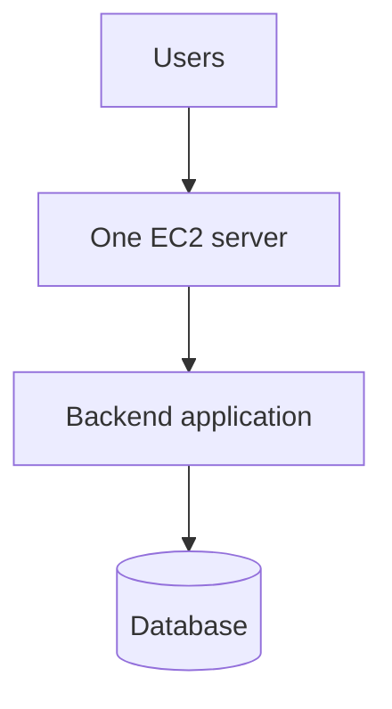

প্রথমে সবকিছু সহজ:

- Server চালু আছে।
- Application process চলছে।
- User request আসছে, application response দিচ্ছে।
- Server-এ SSH করে log দেখা যায়।
- নতুন version deploy করতে process restart করা যায়।

কিন্তু application জনপ্রিয় হতে শুরু করলে, এই সরল setup-এ ফাটল দেখা দেয়।

## 2. Traffic বাড়লে কী কী সমস্যা হয়?

### সমস্যা ১: Server-এর capacity শেষ

ধরো server একসাথে 500টি request ভালোভাবে handle করতে পারে। হঠাৎ 2,000 user request পাঠালে CPU, memory, connection pool বা অন্য কোনো resource bottleneck হতে পারে। Request ধীর হয়ে যায়, timeout হয়, কখনো application crash-ও করতে পারে।

প্রথম সমাধান হতে পারে বড় server নেওয়া। এটাকে সাধারণভাবে **vertical scaling** বা scale up বলা হয়।

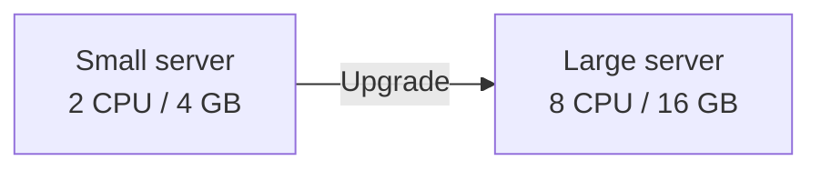

বড় server কিছুদিন সাহায্য করতে পারে। কিন্তু এর সীমা আছে:

- বড় machine-এর দাম দ্রুত বাড়তে পারে।
- Machine-এর সর্বোচ্চ capacity-র সীমা আছে।
- এক machine-এ সব থাকলে machine failure একটি বড় outage তৈরি করতে পারে।
- Capacity বাড়ালেও application-এর একটিমাত্র instance-ই থাকলে application-level failure-এর ঝুঁকি থেকেই যায়।

### সমস্যা ২: একাধিক application instance চালাতে হবে

একটি server-এর বদলে একই application-এর কয়েকটি instance চালানো যায়। একে **horizontal scaling** বা scale out বলে।

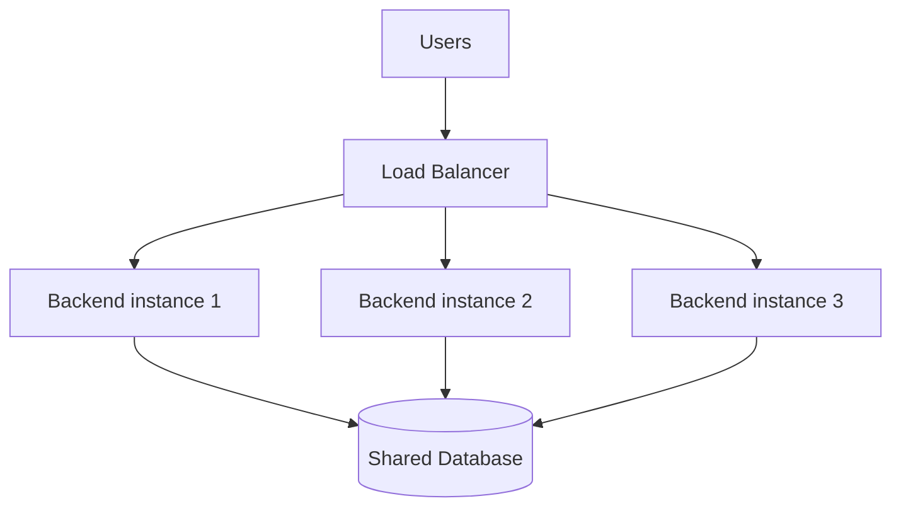

এতে request বিভিন্ন instance-এ ভাগ করা যায়। কিন্তু নতুন প্রশ্ন তৈরি হয়:

- কোন instance-এ request পাঠাব?
- একটি instance মারা গেলে traffic কীভাবে বন্ধ করব?
- Instance-টি আবার কীভাবে চালু করব?
- কতগুলো instance দরকার?
- Traffic কমলে instance কমাব কীভাবে?
- নতুন version deploy করলে সব instance একসাথে restart না করে কীভাবে update করব?

Load balancer traffic ভাগ করতে পারে, কিন্তু application instance তৈরি করা, সেগুলোর health বজায় রাখা, update করা এবং capacity অনুযায়ী সংখ্যা পরিবর্তন করার পুরো দায়িত্ব একা load balancer-এর নয়।

### সমস্যা ৩: Instance মারা গেলে?

তিনটি instance চলছে। একটি process crash করল বা machine নষ্ট হলো।

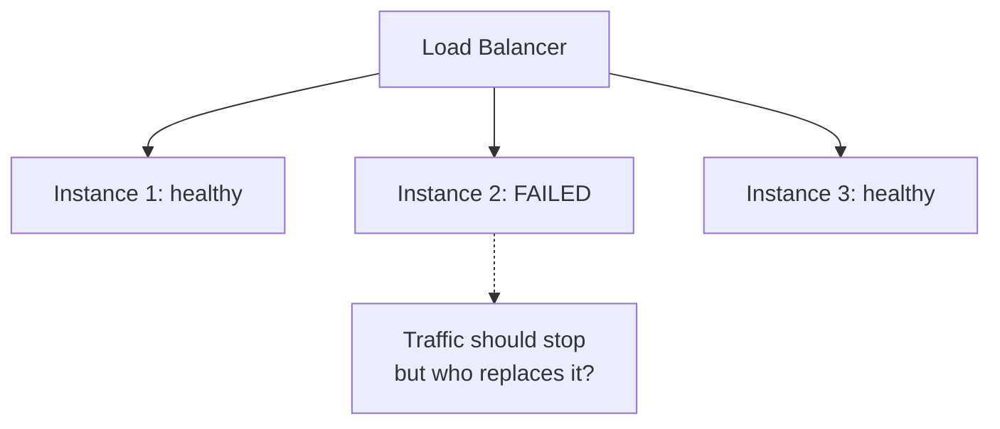

Load balancer হয়তো unhealthy instance-এ traffic পাঠানো বন্ধ করবে। কিন্তু traffic বন্ধ করা আর replacement instance তৈরি করা এক কাজ নয়।

কেউ বা কোনো system-কে জানতে হবে:

1. Desired instance count কত?
2. বর্তমানে healthy instance কতটি?
3. একটি কম থাকলে replacement কোথায় তৈরি হবে?
4. নতুন instance ready হয়েছে কিনা?
5. Ready না হওয়া পর্যন্ত user traffic কীভাবে এড়াবে?

এই দায়িত্বগুলো হাতে সামলানো দ্রুত জটিল হয়ে ওঠে।

---

## 3. Containers আমাদের কী সাহায্য করল?

Application deploy করার আগে dependency, runtime, configuration এবং environment নিয়ে সমস্যা হয়। একটি machine-এ কাজ করা application অন্য machine-এ গিয়ে ভিন্ন version-এর library বা runtime পেয়ে ভেঙে যেতে পারে।

Container image application ও তার প্রয়োজনীয় runtime/dependencies-কে একটি repeatable package-এ সাজায়।

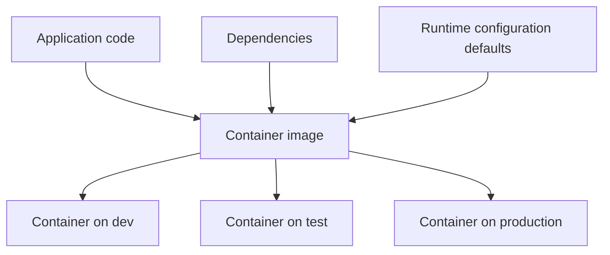

Container আমাদের সাহায্য করে:

- একই image বিভিন্ন environment-এ চালাতে।
- Application release-কে version করতে।
- Deployment-এর সময় dependency install করার অনিশ্চয়তা কমাতে।
- Application-কে infrastructure থেকে কিছুটা বিচ্ছিন্ন করতে।

কিন্তু গুরুত্বপূর্ণ কথা:

> **Container application-কে package করে এবং চালাতে সাহায্য করে। Container fleet পরিচালনা করার সম্পূর্ণ সমাধান এটি নিজে নয়।**

আমরা এখন একটি application-এর container image তৈরি করতে পারি। কিন্তু production-এ 20টি container চালাতে হলে সেগুলো কোথায় চলবে, কীভাবে health monitor হবে, কীভাবে traffic পাবে, failure হলে replacement হবে কিনা, এবং load অনুযায়ী সংখ্যা বাড়বে/কমবে কিনা, এসব প্রশ্নের উত্তর এখনও দরকার।

---

## 4. Container বাড়লে নতুন সমস্যা: Operations

ধরো, application-এর 8টি replica চলছে, 4টি server-এ ভাগ করা।

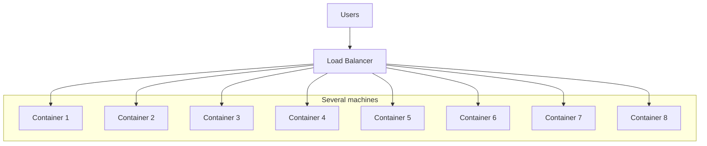

Container-গুলো চালানো সম্ভব, কিন্তু পরিচালনার কাজ বাড়ে। একটি operations platform-কে অন্তত এসব প্রশ্নের উত্তর দিতে হয়:

| প্রশ্ন | আমাদের কী দরকার? |
|---|---|
| কোন machine-এ container চালাব? | Scheduler-এর মাধ্যমে Pod placement / scheduling |
| Container crash করলে? | Health detection ও recovery |
| Instance সংখ্যা কীভাবে বজায় রাখব? | Desired-state management |
| নতুন version deploy করব কীভাবে? | Controlled rollout |
| Traffic কোন instance-এ যাবে? | Service discovery ও load balancing |
| CPU/memory সীমা কীভাবে নির্ধারণ করব? | Resource management |
| Application config কোথায় রাখব? | Configuration management |
| Machine-এ জায়গা না থাকলে? | Capacity management |
| Traffic কমলে অতিরিক্ত instance কীভাবে কমাব? | Scale-in |
| Deployment ভুল হলে? | Rollback / recovery |

এগুলো একেকটি feature নয় মাত্র। এগুলো একসঙ্গে কাজ করার মতো একটি management system-এর প্রয়োজন তৈরি করে।

এখানে **scheduling** বলতে বোঝায়: কোনো নতুন Pod-কে cluster-এর কোন worker machine বা Node-এ চালানো হবে, সেই সিদ্ধান্ত। Kubernetes Scheduler বিদ্যমান Node-গুলোর capacity ও Pod-এর requirements দেখে এই সিদ্ধান্ত নেয়। Node-এ জায়গা না থাকলে Scheduler নিজে নতুন machine বানায় না; Pod Pending থাকতে পারে।

---

## 5. Kubernetes-এর আগে: এগুলো কি নিজে করা যেত না?

অবশ্যই যেত। Kubernetes আসার আগে এবং Kubernetes ছাড়া আজও বিভিন্ন tool, script, cloud service ও platform দিয়ে এই কাজগুলো করা হয়।

নিজস্ব scripts দিয়ে:

- Instance তৈরি করা
- Process/container চালু করা
- Health check করা
- Failure হলে restart করা
- Load balancer update করা
- Deployment script চালানো

Cloud services দিয়ে:

- Virtual machine তৈরি করা
- Instance group পরিচালনা করা
- Load balancing
- Metrics-ভিত্তিক scaling

কিন্তু custom automation-এর একটি সমস্যা হলো, application বড় হওয়ার সাথে সাথে অনেক script, trigger, state, retry, failure handling ও dependency একে অপরের সাথে জড়িয়ে যেতে পারে।

যেমন, একটি script instance তৈরি করল, আরেকটি script load balancer update করল, আরেকটি health check করল। Instance তৈরি হলেও application ready না হলে traffic পাঠানো যাবে না। Script মাঝপথে ব্যর্থ হলে? একই কাজ দুইবার trigger হলে? পুরনো instance সরানোর আগে নতুন instance ready না হলে?

এসব সমস্যা সমাধান সম্ভব, কিন্তু একটি consistent system তৈরি ও maintain করার খরচ বাড়তে থাকে।

Kubernetes এই management problem-কে একটি সাধারণ API, desired state এবং continuously running control processes-এর মাধ্যমে সমাধানের চেষ্টা করে।

---

## 6. Kubernetes আসলে কী করে?

Kubernetes একটি open-source platform, যা containerized application deploy, manage ও scale করতে সাহায্য করে। এর একটি মৌলিক বৈশিষ্ট্য হলো: তুমি শুধু কোনো কাজের command দাও না, বরং application-কে কোন অবস্থায় রাখতে চাও সেটিও declare করো।

যেমন:

> “আমার application-এর 3টি replica চলতে থাকা দরকার।”

Kubernetes-এর বিভিন্ন component মিলে সেই চাহিদা পূরণের চেষ্টা করে। এই ধারণাটির নাম **desired state**। Section 8-এ আমরা desired state, actual state এবং তাদের মধ্যে পার্থক্য তৈরি হলে Kubernetes কীভাবে প্রতিক্রিয়া জানায়, তা আলাদা করে দেখব।

উদাহরণ:

- তুমি 3টি replica চাও।
- বর্তমানে 3টি চলছে।
- একটি **Pod** terminate হয়ে গেলে desired count-এর তুলনায় একটি Pod কম থাকে।
- Deployment-এর অধীনে থাকা ReplicaSet controller প্রয়োজনীয় replacement Pod তৈরি করে।
- Scheduler replacement Pod-টিকে উপযুক্ত Node-এ assign করার চেষ্টা করে।
- Node-এর kubelet এবং container runtime সেখানে container চালু করে।

এখানে Process, Container, Pod এবং Node failure এক ঘটনা নয়:

- **Application process crash:** Container-এর প্রধান process শেষ হয়ে যেতে পারে। Deployment-এর মতো workload-এ সাধারণত `restartPolicy: Always` থাকে, তাই kubelet একই Pod-এর container আবার চালু করার চেষ্টা করে।
- **Container failure:** Pod-এর `restartPolicy` অনুযায়ী kubelet container-টিকে আবার চালু করার চেষ্টা করে; এতে Pod-টি একই থাকতে পারে।
- **Pod failure বা deletion:** Pod আর recover করা সম্ভব না হলে Deployment-এর অধীনে থাকা ReplicaSet প্রয়োজন অনুযায়ী replacement Pod তৈরি করে। নতুন Pod পুরোনো Pod-এর একই object নয়; এটি নতুন Pod identity নিয়ে তৈরি হয়।
- **Node failure:** পুরো Node unavailable হলে সেখানে থাকা Pod-গুলোও unavailable হয়। Node-এর অবস্থা শনাক্ত হওয়া, Pod-গুলোকে failed/evicted হিসেবে বিবেচনা করা এবং replacement তৈরি হওয়ার মধ্যে কিছু সময় লাগতে পারে। Workload controller তখন অন্য উপযুক্ত Node-এ replacement Pod চালানোর চেষ্টা করে।

এই পার্থক্যগুলো মনে রাখলেই failure হলে Kubernetes ঠিক কী recover করছে, তা গুলিয়ে যাবে না। বিস্তারিত lifecycle পরের chapter-গুলোতে আসবে।

---

## 7. “স্কেল করার জন্য AWS ASG আছে, Kubernetes কেন?”

এখানে একটা গুরুত্বপূর্ণ প্রশ্ন আছে: AWS যদি নিজেই EC2 instance বাড়াতে ও কমাতে পারে, তাহলে Kubernetes আবার কী যোগ করছে?

উত্তরটা বুঝতে হলে আগে application আর server-কে আলাদা করে দেখতে হবে।

### 7.1 আগে বুঝি: Pod আসলে কী?

ধরো, তোমার একটি backend application আছে। Docker image থেকে application-টি চালালে একটি container তৈরি হয়।

Kubernetes-এ সাধারণত container-কে সরাসরি manage না করে **Pod** নামের একটি unit-এর মধ্যে চালানো হয়।

সহজভাবে, চারটি ধারণা আলাদা করে দেখি:

- **Process:** Operating System-এ চলমান একটি program-এর execution। যেমন তোমার API server চালু হলে তার একটি বা একাধিক process চলতে পারে।
- **Container:** Process চালানোর জন্য isolated environment। এতে application-এর filesystem, dependencies, configuration এবং runtime boundary থাকে। একটি container-এ সাধারণত একটি প্রধান application process চালানো হয়, যদিও প্রয়োজন হলে একাধিক process-ও চলতে পারে। Container নিজে process নয়; process-কে চালানোর ও isolate করার environment।
- **Pod:** Kubernetes-এর সবচেয়ে ছোট deployable ও scheduling unit। একটি Pod-এ এক বা একাধিক container থাকতে পারে। একই Pod-এর container-গুলো network namespace (যেমন একই Pod IP ও localhost) এবং নির্দিষ্ট volume share করতে পারে।
- **Replica:** কোনো workload-এর একটি running copy। Deployment-এর ক্ষেত্রে সাধারণত প্রতিটি replica একটি Pod। তাই 3টি replica বলতে সাধারণত একই application-এর 3টি Pod বোঝায়, 3টি container বা 3টি process নয়।

ধরো, আমাদের API application-এর 3টি replica দরকার:

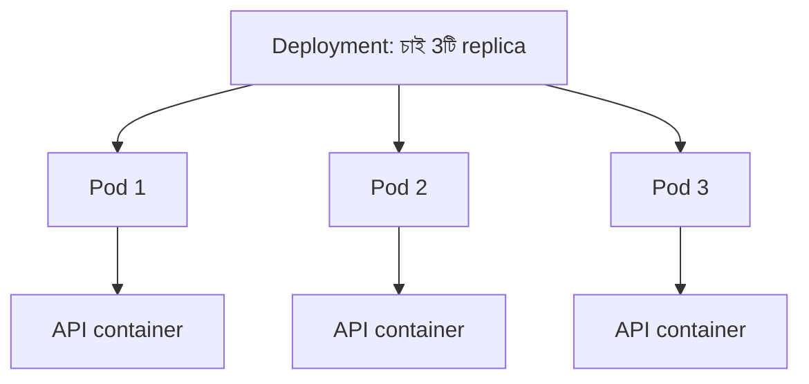

অর্থাৎ, Kubernetes-কে আমরা বলছি: “আমার API application-এর 3টি copy চালু রাখো।” এই copy-গুলো Pod হিসেবে চলে।

### 7.2 HPA কী করে?

**HPA-এর পূর্ণরূপ Horizontal Pod Autoscaler।** নামের মধ্যেই কাজের পরিচয় আছে:

- Horizontal: একই application-এর copy বাড়ানো বা কমানো।
- Pod: Kubernetes-এ application চালানোর unit।
- Autoscaler: নির্দিষ্ট metric দেখে replica সংখ্যা স্বয়ংক্রিয়ভাবে পরিবর্তন করে।

ধরো, তোমার API-র 2টি Pod চলছে। তুমি HPA-কে এমন policy দিলে যে Pod-গুলোর গড় CPU usage নির্দিষ্ট target-এর চেয়ে বেশি হলে replica বাড়াতে হবে, আর কম থাকলে কমাতে হবে।

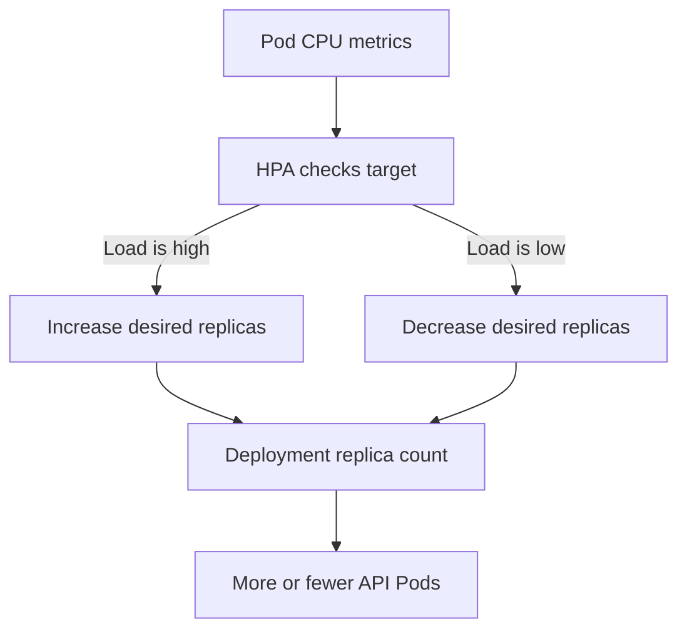

একটি সরল উদাহরণ:

| অবস্থা | API Pod-এর সংখ্যা |
|---|---:|
| স্বাভাবিক traffic | 2 |
| Traffic বেড়েছে, CPU target ছাড়িয়েছে | 4 |
| Traffic আরও বেড়েছে | 6 |
| Traffic কমে গেছে | 2 |

এটি বোঝানোর জন্য সরল উদাহরণ। CPU utilization বোঝার জন্য একটি বিষয় জরুরি: HPA CPU usage-কে সংশ্লিষ্ট container-গুলোর CPU **request**-এর তুলনায় হিসাব করে। একটি container-যুক্ত Pod-এর ক্ষেত্রে CPU request `500m` এবং গড় usage `400m` হলে utilization হলো `80%` (`400 ÷ 500 × 100`)। একাধিক container থাকলে তাদের usage ও request একসঙ্গে বিবেচিত হয়।

CPU utilization target ব্যবহার করতে হলে সংশ্লিষ্ট container-গুলোর CPU request define করা থাকা দরকার। কোনো container-এর request না থাকলে সেই Pod-এর utilization নির্ভরযোগ্যভাবে হিসাব করা যায় না; ফলে HPA-এর metric calculation অসম্পূর্ণ হতে পারে।

বাস্তবে HPA নির্দিষ্ট সময়ের metrics, target utilization, minimum ও maximum replica এবং scaling behavior বিবেচনা করে। CPU ছাড়াও memory বা custom/external metric ব্যবহার করা যায়, উপযুক্ত metrics integration থাকলে।

একটি গুরুত্বপূর্ণ বিষয়: **HPA নিজে নতুন server বা EC2 instance তৈরি করে না।** HPA শুধু Kubernetes-কে জানায়, “এই application-এর Pod replica এতগুলো হওয়া দরকার।”

আর HPA কাজ করতে metrics সরবরাহকারী ব্যবস্থা প্রয়োজন। যেমন CPU/memory metrics-এর জন্য সাধারণত Metrics Server ব্যবহৃত হয়। HPA traffic-এর সংখ্যা নিজে থেকে জাদুর মতো জানে না; তাকে যে metric configure করা হয়েছে সেটির ওপর সিদ্ধান্ত নেয়।

### 7.3 Scheduler কী? এর কাজ কী?

এখন ধরো HPA বলল, 2টির বদলে 5টি Pod দরকার। Kubernetes 3টি নতুন Pod তৈরি করার চেষ্টা করল। কিন্তু Pod তৈরি করলেই তো সেগুলো কোনো machine-এ চলবে না। কোন machine-এ চলবে, সেটি ঠিক করতে হয়।

এই কাজ করে **Kubernetes Scheduler**।

Cluster-এ যে machine-গুলো Kubernetes-এর worker node হিসেবে যুক্ত আছে, সেগুলোর মধ্যে কোনটিতে নতুন Pod চালানো সম্ভব, Scheduler তা নির্বাচন করে।

ধরো:

- Node A-তে CPU ও memory-র পর্যাপ্ত জায়গা আছে।
- Node B প্রায় পূর্ণ।
- Node C-তে Pod চালানোর জন্য প্রয়োজনীয় memory নেই।

Scheduler Pod-এর resource request (যেমন CPU ও memory), node-এ available capacity এবং অন্যান্য scheduling constraint বিবেচনা করে উপযুক্ত Node নির্বাচন করে। উদাহরণ হিসেবে `nodeSelector`/node affinity, taint ও toleration, এবং volume topology-এর মতো constraint scheduling-কে প্রভাবিত করতে পারে।

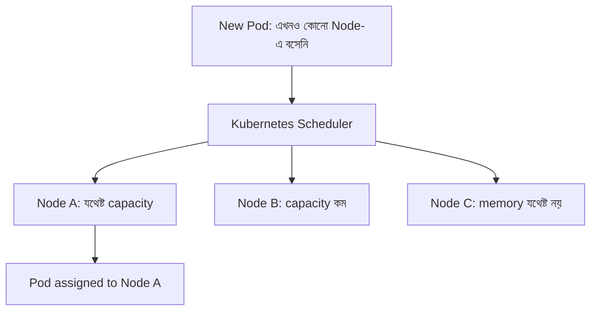

সহজ ভাষায়, Scheduler হলো cluster-এর **কোন Pod কোন worker machine-এ চলবে, সেই সিদ্ধান্ত নেওয়ার component**।

Scheduler যা করে না:

- নতুন EC2 instance তৈরি করে না।
- নিজে application container চালায় না।
- CPU বা memory বাড়িয়ে দেয় না।

এটি শুধু উপযুক্ত বিদ্যমান node বেছে নেয়। নির্বাচিত node-এ Pod চালানোর কাজ করে সেই node-এর kubelet ও container runtime। এগুলো আমরা Architecture chapter-এ বিস্তারিত শিখব।

### 7.4 তাহলে Pod-এর জন্য Node না থাকলে কী হয়?

ধরো HPA 2টি থেকে 8টি Pod করতে বলেছে। কিন্তু বর্তমান EC2 machine-গুলোতে জায়গা আছে মাত্র 5টি Pod-এর।

- 5টি Pod Node-এ schedule হয়ে চলতে পারে।
- বাকি 3টি Pod তৈরি হলেও কোনো Node-এ জায়গা না থাকায় **Pending** অবস্থায় থাকবে।
- Scheduler উপযুক্ত Node খুঁজতে থাকবে, কিন্তু capacity না থাকলে সেগুলো schedule করতে পারবে না।

তবে মনে রেখো, **সব Pending Pod-এর কারণ capacity shortage নয়**। Pod Pending হতে পারে insufficient CPU/memory, `nodeSelector` বা affinity mismatch, untolerated taint, অথবা প্রয়োজনীয় PersistentVolume পাওয়া না যাওয়ার কারণেও। নতুন Node যোগ করলেই সব ধরনের Pending সমস্যা সমাধান হবে না।

Node autoscaler তখনই সাহায্য করতে পারে, যখন নতুন উপযুক্ত Node যোগ হলে Pod-টি schedule করা সম্ভব হবে। তাই Pending status দেখেই অন্ধভাবে Node বাড়ানো হয় না; scheduling failure-এর কারণও বুঝতে হয়।

### 7.5 AWS ASG-এর সঙ্গে Kubernetes কীভাবে কাজ করে?

এখন দুইটি আলাদা দায়িত্ব পাশাপাশি রাখি:

1. **HPA:** Application-এর কতগুলো Pod দরকার, তা নির্ধারণ করে।
2. **Node autoscaler:** Pod চালানোর মতো worker node কম থাকলে আরও machine যোগ করার ব্যবস্থা করে।

AWS-এ এই node autoscaling করার একাধিক উপায় আছে। বহুল ব্যবহৃত একটি arrangement বোঝা যাক।

#### ASG একা Kubernetes-এর Pod বোঝে না

AWS Auto Scaling Group (ASG) EC2 instance-এর সংখ্যা বাড়াতে বা কমাতে পারে। কিন্তু ASG নিজে জানে না:

- তোমার API-র কয়টি Pod দরকার,
- কোন Pod Pending অবস্থায় আছে,
- কোন worker node-এ CPU/memory-র জায়গা নেই।

ASG-এর কাজ EC2 instance fleet পরিচালনা করা। Kubernetes-এর workload কী চায়, তা ASG-কে বোঝানোর জন্য মাঝখানে integration বা node autoscaling component লাগে।

#### Cluster Autoscaler কীভাবে ASG-কে সাহায্য করে?

ধরো, EKS cluster-এ worker node-গুলো একটি EC2 Auto Scaling Group বা EKS Managed Node Group দিয়ে তৈরি করা হয়েছে।

Cluster Autoscaler cluster-এর অবস্থা দেখে। কিছু Pod scheduling-এর জন্য unschedulable থাকলে এটি যাচাই করে configured node group-এর উপযুক্ত Node যোগ করলে Pod-গুলো schedule করা সম্ভব হবে কি না। সম্ভব হলে এটি উপযুক্ত node group-এর size বাড়ানোর জন্য AWS-এর সঙ্গে কাজ করে। Node group-এর পেছনে ASG থাকলে ASG নতুন EC2 instance চালু করে। এটি কাজ করার জন্য node group discovery, IAM permission, scaling limits এবং সঠিক cluster configuration প্রয়োজন।

নতুন EC2 instance Kubernetes cluster-এ worker node হিসেবে যুক্ত হলে Scheduler আবার Pending Pod-গুলোর জন্য জায়গা খুঁজতে পারে।

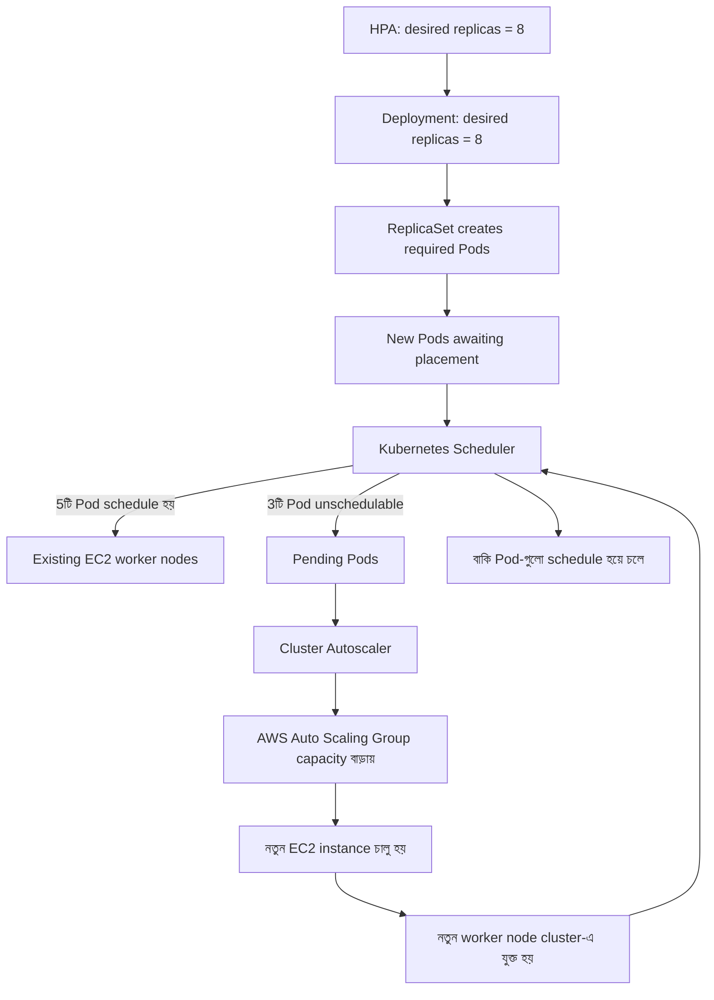

এই flow-তে ASG আর Kubernetes একই কাজ করছে না:

- Kubernetes/HPA application-এর replica চাহিদা জানায়।
- Scheduler দেখে Pod কোথায় চালানো সম্ভব।
- Cluster Autoscaler বুঝতে সাহায্য করে যে আরও node দরকার।
- ASG EC2 machine-এর সংখ্যা বাড়ায়।
- নতুন machine cluster-এ যুক্ত হলে Scheduler সেখানে Pod বসায়।

**অর্থাৎ, হ্যাঁ, Kubernetes-based system AWS-এ প্রয়োজন হলে ASG-এর মাধ্যমে EC2 instance বাড়াতে পারে। কিন্তু Kubernetes Scheduler বা HPA সরাসরি ASG-কে scale করে না। Cluster Autoscaler-এর মতো integration এই দুই layer-কে যুক্ত করে।**

#### Karpenter কী?

Karpenter আরেকটি node autoscaling/provisioning tool। এটিও Pending Pod-এর resource requirement দেখে নতুন worker node দরকার কিনা নির্ধারণ করতে পারে। তবে Cluster Autoscaler-এর মতো আগে থেকে নির্ধারিত ASG-এর desired capacity বাড়ানোর পথেই শুধু কাজ করে না। AWS-এ Karpenter প্রয়োজন অনুযায়ী EC2 instance provision করার জন্য AWS API ব্যবহার করতে পারে।

এই chapter-এর জন্য শুধু পার্থক্যটি মনে রাখো:

- **Cluster Autoscaler:** সাধারণত বিদ্যমান node group/ASG-এর capacity adjust করে।
- **Karpenter:** প্রয়োজন অনুযায়ী উপযুক্ত EC2 instance বেছে নিয়ে সরাসরি provision করতে পারে।

দুটিরই configuration, permission এবং infrastructure setup দরকার। এগুলো Kubernetes core-এর মধ্যে স্বয়ংক্রিয়ভাবে চালু থাকে না। Cluster Autoscaler বা Karpenter কোনোটিই প্রতিটি Pending Pod-এর সমাধান নয়; Pod-এর scheduling constraint নতুন Node দিয়েও পূরণ করা সম্ভব হতে হবে।

### 7.6 দুই ধরনের scaling একসঙ্গে: সম্পূর্ণ উদাহরণ

এবার পুরো বিষয়টি একটি উদাহরণে দেখি।

শুরুতে:
- 2টি EC2 worker node আছে।
- API application-এর 2টি Pod চলছে।

Traffic বেড়ে গেল:
1. Pod-এর CPU usage বেড়ে গেল।
2. HPA metrics দেখে API-র desired replica 2 থেকে 8 করল।
3. Kubernetes 6টি অতিরিক্ত Pod তৈরি করার চেষ্টা করল।
4. Scheduler existing node-এ যতগুলো Pod চালানো সম্ভব, সেগুলো assign করল।
5. জায়গা না থাকায় কিছু Pod Pending রইল।
6. Cluster Autoscaler বুঝল আরও worker node দরকার।
7. AWS ASG নতুন EC2 instance চালু করল।
8. নতুন EC2 instance Kubernetes worker node হিসেবে যুক্ত হলো।
9. Scheduler Pending Pod-গুলো নতুন node-এ assign করল।

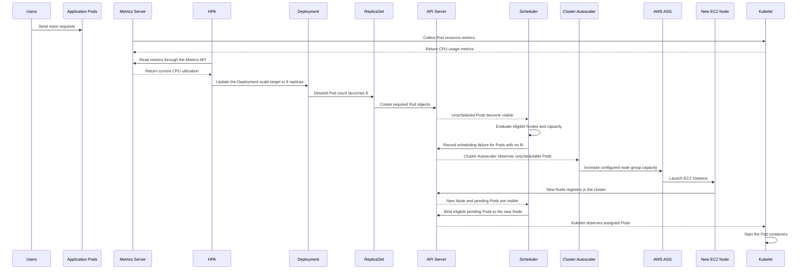

Traffic পরে কমে গেলে HPA Pod replica কমাতে পারে। Node autoscaler-ও খালি বা কম ব্যবহৃত Node সরানোর চেষ্টা করতে পারে, যদি configuration ও safety condition তা অনুমোদন করে। ফলে application-এর Pod সংখ্যা এবং EC2 machine-এর সংখ্যা দুইটি আলাদা policy অনুযায়ী বাড়ে বা কমে।

এই উদাহরণে HPA, Deployment, Scheduler, kubelet, Cluster Autoscaler এবং ASG-এর দায়িত্ব আলাদা:

| Component | মূল দায়িত্ব |
|---|---|
| Deployment | Application rollout পরিচালনা করে এবং ReplicaSet-এর মাধ্যমে কাঙ্ক্ষিত Pod replica count প্রকাশ করে |
| ReplicaSet | নির্দিষ্ট সংখ্যক Pod replica বজায় রাখার চেষ্টা করে |
| HPA | Metrics ও policy দেখে scale target-এর desired replica count পরিবর্তন করে |
| Scheduler | Pending Pod-এর জন্য উপযুক্ত বিদ্যমান Node নির্বাচন করা |
| Kubelet | নিজের Node-এ Pod ও container-এর lifecycle পরিচালনা করা |
| Cluster Autoscaler | নতুন Node যোগ করলে schedule হতে পারে এমন unschedulable Pod-এর জন্য node group capacity বাড়ানোর চেষ্টা করা |
| AWS ASG | EC2 instance-এর সংখ্যা পরিচালনা করা |

### 7.7 ASG বনাম Kubernetes: সংক্ষেপে

| প্রশ্ন | AWS ASG | Kubernetes ও সংশ্লিষ্ট component |
|---|---|---|
| Application-এর কয়টি copy চলবে? | সরাসরি Pod replica বোঝে না | Deployment replica নির্ধারণ করে; HPA metric অনুযায়ী replica বদলাতে পারে |
| কোন machine-এ Pod চলবে? | Kubernetes Pod schedule করে না | Scheduler উপযুক্ত worker node নির্বাচন করে |
| নতুন EC2 machine দরকার হলে? | EC2 instance launch/terminate করে | Cluster Autoscaler বা Karpenter-এর মতো node autoscaler প্রয়োজনীয় capacity চায় |
| Application Pod crash করলে? | সাধারণত container-level recovery ASG-এর কাজ নয় | Workload controller replacement Pod তৈরি করার চেষ্টা করে |
| Application update কীভাবে হবে? | EC2 instance refresh-এর mechanism আছে | Kubernetes Deployment rolling update পরিচালনা করতে পারে |

> **ASG ও Kubernetes একে অপরের replacement নয়।** ASG machine পরিচালনা করে; Kubernetes application workload পরিচালনা করে। Node autoscaler এই দুই layer-এর মধ্যে সংযোগ তৈরি করে।

### 7.8 তাহলে শুধু ASG দিয়েই কি application চালানো যায়?

হ্যাঁ। Kubernetes সব application-এর জন্য বাধ্যতামূলক নয়।

Application ছোট ও সহজ হলে, কয়েকটি EC2 instance-এ deploy করা হলে এবং deployment/recovery/scaling automation সহজে পরিচালনা করা গেলে ASG + Load Balancer + deployment automation যথেষ্ট হতে পারে।

Kubernetes-এর মূল্য বাড়ে যখন অনেক containerized workload পরিচালনা করতে হয় এবং scheduling, health, rollout, service discovery, configuration, resource management ও application-level scaling-এর জন্য একটি consistent platform দরকার হয়।

তবে Kubernetes নিজেও complexity নিয়ে আসে: cluster পরিচালনা, networking, storage, security, upgrades, observability এবং troubleshooting শিখতে ও maintain করতে হয়। ছোট application-এর জন্য এটি অতিরিক্ত operational burden হতে পারে।

**Kubernetes ব্যবহার করলেই খরচ কমবে বা system সহজ হবে, এমন নিশ্চয়তা নেই।** এটি অনেক operational কাজকে একটি platform ও API-তে সংগঠিত করে, কিন্তু platform পরিচালনার দায়িত্বও তৈরি করে।

---

## 8. Kubernetes-এর মূল mental model: Desired State বনাম Actual State

Section 6-এ আমরা desired state-এর সঙ্গে পরিচিত হয়েছি। এবার ধারণাটিকে একটু নির্দিষ্ট করে দেখি।

- **Desired state:** তুমি Kubernetes-কে যে কাঙ্ক্ষিত অবস্থা declare করো। যেমন, একটি Deployment-এর `replicas: 3`।
- **Actual state:** Cluster-এ এই মুহূর্তে বাস্তবে যতগুলো Pod আছে এবং সেগুলোর অবস্থা কী।

ধরো, Deployment-এ 3টি replica চাওয়া হয়েছে, কিন্তু বর্তমানে মাত্র 2টি Pod আছে। Desired state ও actual state-এর মধ্যে mismatch তৈরি হয়েছে।

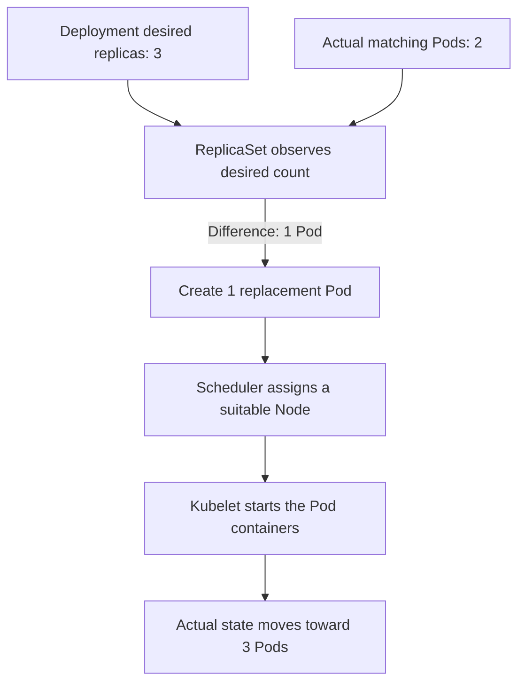

এই diagram-এ একটি গুরুত্বপূর্ণ বিষয় খেয়াল করো: Deployment-এর desired replica count ReplicaSet-এর মাধ্যমে বাস্তবায়িত হয়। Scheduler নিজে Pod তৈরি করে না; সে তৈরি হওয়া, এখনো Node-এ assign না হওয়া Pod-এর জন্য উপযুক্ত Node নির্বাচন করে।

**Reconciliation** হলো এই পার্থক্য পর্যবেক্ষণ করে প্রয়োজনীয় corrective action নেওয়া এবং আবার state পরীক্ষা করার ধারাবাহিক প্রক্রিয়া। এটি একবারের command নয়; controller-গুলো বারবার কাজটি করে। কোনো action নেওয়া মানেই desired state সঙ্গে সঙ্গে পাওয়া যাবে এমন নয়। পর্যাপ্ত resource বা উপযুক্ত Node না থাকলে actual state কিছু সময়ের জন্য desired state থেকে আলাদা থাকতে পারে।

Chapter 10-এ আমরা reconciliation loop, controller, API server ও watch-এর ভিতরের mechanics বিস্তারিত দেখব। এখানে শুধু mental model-টি মনে রাখো।

---

## 9. Kubernetes কী কী করে, আর কী করে না?

### Kubernetes যেসব সমস্যার সমাধান করতে সাহায্য করে

- Containerized workloads deploy ও manage করা।
- Desired replica count বজায় রাখার চেষ্টা করা।
- Container/Pod failure থেকে recovery-র ব্যবস্থা করা।
- Application rollout এবং rollback পরিচালনা করা।
- Service discovery ও workload traffic abstraction।
- Resource requests/limits ও scheduling।
- Configuration ও secret resource পরিচালনা।
- Metrics-এর ভিত্তিতে workload autoscaling-এর extensible mechanism।

### Kubernetes সব সমস্যার সমাধান করে না

Kubernetes নিজে:

- তোমার application code bug fix করে না।
- Database-এর data correctness নিশ্চিত করে না।
- সব failure-এ zero downtime guarantee করে না।
- Application-এর জন্য CI pipeline বা source code build system বাধ্যতামূলকভাবে সরবরাহ করে না।
- সব cloud infrastructure স্বয়ংক্রিয়ভাবে provision করে না, যদি সেই integration/configuration না থাকে।
- Logging, monitoring, tracing-এর পূর্ণ solution বাধ্যতামূলকভাবে দেয় না।
- Cluster administration, security, networking, storage, upgrades ও cost management-এর দায়িত্ব মুছে দেয় না।

Kubernetes একটি powerful platform, কিন্তু magic নয়। Application এবং infrastructure-এর design ভালো না হলে Kubernetes সেই সমস্যাগুলোকে শুধু অন্য জায়গায় নিয়ে যেতে পারে।

---

## 10. Experiment: Kubernetes ছাড়া application পরিচালনার চিন্তা করো

এই প্রথম chapter-এ cluster তৈরি করব না। আগে একটি thought experiment করি। পরবর্তী chapter-এ local environment তৈরি করে বাস্তব Kubernetes experiment শুরু করব।

### Scenario

একটি API application-এর 3টি replica চলছে। একটি replica crash করল। Desired count এখনও 3।

### Exercise A: Manual operations

তুমি Kubernetes ছাড়া কাজ করছ। নিচের প্রশ্নগুলোর উত্তর লেখো:

1. কীভাবে বুঝবে একটি replica crash করেছে?
2. কীভাবে নিশ্চিত করবে load balancer মৃত replica-তে traffic পাঠাচ্ছে না?
3. Replacement instance/container কোথায় তৈরি করবে?
4. Replacement application ready না হওয়া পর্যন্ত traffic কীভাবে আটকাবে?
5. Replacement তৈরি করতে গিয়ে কোনো operation ব্যর্থ হলে কী করবে?
6. এই কাজগুলো 20টি service-এর জন্য করতে হলে automation কোথায় রাখবে?

### Exercise B: Demand বৃদ্ধি

ধরো, normal traffic-এ 3টি replica যথেষ্ট, কিন্তু peak traffic-এ 12টি দরকার।

- কোন metric দেখে replica বাড়ানোর সিদ্ধান্ত নেবে?
- Replica বাড়ানোর পর machine capacity না থাকলে কী হবে?
- Traffic কমলে replica কমানোর সিদ্ধান্ত কে নেবে?
- Replica সংখ্যা বাড়ানো এবং EC2 সংখ্যা বাড়ানো কি একই সিদ্ধান্ত?

এই প্রশ্নগুলোর উত্তর Kubernetes শেখার সময় আমরা একে একে খুঁজে বের করব।

---

## 11. Checkpoint

নিজের ভাষায় উত্তর দেওয়ার চেষ্টা করো:

1. Container থাকলেই কেন production application পরিচালনার সমস্যা শেষ হয় না?
2. Load balancer এবং application recovery system-এর দায়িত্ব কি এক?
3. Vertical scaling ও horizontal scaling-এর পার্থক্য কী?
4. AWS ASG কী scale করে? Kubernetes HPA কী scale করে?
5. Kubernetes ছাড়া কি autoscaling সম্ভব? কীভাবে?
6. Kubernetes-এর desired state ধারণাটি কেন গুরুত্বপূর্ণ?
7. Kubernetes কি সব application-এর জন্য দরকার? কেন বা কেন নয়?
8. Pod replicas বাড়লেও কেন নতুন EC2 instance সবসময় দরকার হয় না?

এই প্রশ্নগুলোতে আটকে গেলে সমস্যা নেই। Chapter 01 ও পরবর্তী hands-on labs-এর জন্য এগুলোই আমাদের foundation।

---

## Key Takeaways

- Application ছোট থাকলে manually deploy ও operate করা সম্ভব, কিন্তু workload, traffic এবং failure বাড়লে operations জটিল হয়।
- Containers application packaging ও runtime consistency উন্নত করে; container fleet management-এর সব সমস্যা সমাধান করে না।
- Scaling একাধিক layer-এ হয়: application replica এবং infrastructure capacity।
- AWS ASG EC2 instance capacity scale করে। Kubernetes workload replicas পরিচালনা করে। Node autoscaling-এর জন্য Kubernetes cluster-এ অতিরিক্ত integration/solution লাগে।
- Kubernetes-এর শক্তিশালী ধারণা হলো declarative desired state ও continuous reconciliation।
- Kubernetes operational complexity দূর করে না; এটি সেই complexity-কে একটি extensible platform ও consistent API-এর মাধ্যমে পরিচালনা করার উপায় দেয়।
- সব application-এ Kubernetes প্রয়োজন নেই। System complexity এবং operational needs অনুযায়ী tool বেছে নিতে হয়।

## Next Chapter

**Chapter 01: Kubernetes Architecture**

পরবর্তী chapter-এ Kubernetes Cluster, Control Plane, Worker Node, API Server, Scheduler, Controller Manager এবং kubelet-এর ভূমিকা বুঝব। Chapter 00-তে যে “কে এই কাজগুলো করবে?” প্রশ্নগুলো তুলেছি, Architecture chapter-এ সেগুলোর উত্তর খুঁজে শুরু করব।

---

## Further Reading

- [Kubernetes: Overview](https://kubernetes.io/docs/concepts/overview/)
- [Kubernetes: Cluster Architecture](https://kubernetes.io/docs/concepts/architecture/)
- [Kubernetes: Workloads](https://kubernetes.io/docs/concepts/workloads/)
- [Kubernetes: Autoscaling Workloads](https://kubernetes.io/docs/concepts/workloads/autoscaling/)
- [Amazon EKS: Kubernetes Concepts](https://docs.aws.amazon.com/eks/latest/userguide/kubernetes-concepts.html)
