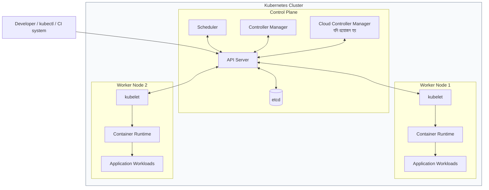
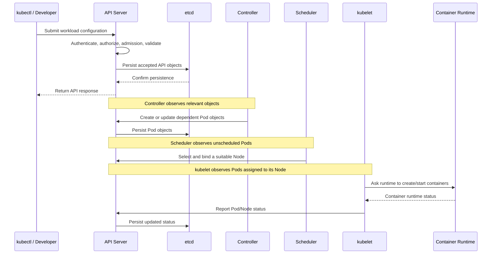

# Chapter 01: Kubernetes Architecture

> Chapter 00-তে আমরা দেখেছি container চালু রাখার পাশাপাশি application-এর replica, machine capacity, failure এবং recovery পরিচালনার জন্য একটি orchestration platform কেন প্রয়োজন। এবার দেখব Kubernetes cluster-এর ভেতরে সেই দায়িত্বগুলো কারা পালন করে এবং তারা কীভাবে একসঙ্গে কাজ করে।

[← Tutorial home](../../README.md) · [← Chapter 00: Kubernetes-এর ভিত্তি](../00-kubernetes-foundation/README.md)

## এই অধ্যায়ে কী শিখবে

এই chapter শেষে তুমি:

- Kubernetes **Cluster**, **Control Plane** এবং **Node**-এর সম্পর্ক ব্যাখ্যা করতে পারবে।
- Control Plane-এর প্রধান component-গুলোর দায়িত্ব আলাদা করতে পারবে।
- Worker Node-এ kubelet, container runtime এবং networking/storage plugin-এর ভূমিকা বুঝবে।
- একটি API request কীভাবে cluster-এর বিভিন্ন component-এর মধ্যে ছড়িয়ে পড়ে, তার high-level flow অনুসরণ করতে পারবে।
- Kubernetes-এর core component এবং CNI/CSI-এর মতো plugin বা cloud integration-এর পার্থক্য বুঝবে।
- কোনো component unavailable হলে cluster-এর কোন capability প্রভাবিত হবে, তা reasoning করতে পারবে।
- Kind cluster inspect করে diagram-এর সঙ্গে বাস্তব component মিলিয়ে দেখতে পারবে।

এই chapter-এ architecture-এর mental model তৈরি করব। Pod-এর গঠন ও lifecycle Chapter 02-তে, workload controller Chapter 03-তে, networking Chapter 04-তে এবং scheduling/resource management Chapter 07-তে বিস্তারিত আসবে। API Server, etcd, controller ও reconciliation-এর internal mechanics Chapter 10-তে আরও গভীরভাবে দেখব।

---

## 1. Kubernetes Cluster আসলে কী?

Kubernetes **Cluster** হলো একাধিক machine বা machine-এর সমতুল্য node এবং তাদের সমন্বয় করে এমন control system-এর সমষ্টি।

একটি cluster-কে দুইটি logical অংশে ভাবা যায়:

1. **Control Plane:** Cluster-এর state ও workload পরিচালনার সিদ্ধান্ত এবং coordination করে।
2. **Worker Node:** Application-এর workload চালায়।

এখানে একটি গুরুত্বপূর্ণ পার্থক্য মনে রাখো: Control Plane ও Worker Node হলো responsibility-এর logical boundary। সব environment-এ এগুলো অবশ্যই আলাদা physical machine-এ থাকবে, এমন নয়। ছোট local cluster-এ একই node control-plane role এবং workload চালানোর কাজ দুটোই করতে পারে। Production cluster-এ সাধারণত workload node-গুলোকে control-plane node থেকে আলাদা রাখা হয়।

### Cluster-এর high-level ছবি

Diagram-টি architecture-এর logical view। বাস্তবে component-গুলো API Server-এর মাধ্যমে Kubernetes object ও state নিয়ে যোগাযোগ করে। সব component একে অপরকে সরাসরি call করে না। পরের section-গুলোতে এই boundary পরিষ্কার হবে।

---

## 2. Control Plane: Cluster-এর coordination layer

Control Plane cluster-এর shared state এবং workload management-এর কেন্দ্রীয় দায়িত্ব পালন করে। এর প্রধান component-গুলো হলো:

- kube-apiserver
- etcd
- kube-scheduler
- kube-controller-manager
- cloud-controller-manager (cloud integration প্রয়োজন হলে)

সব cluster-এ cloud-controller-manager থাকবে এমন নয়। Managed Kubernetes service-এ Control Plane-এর machine ও কিছু component cloud provider পরিচালনা করতে পারে।

### 2.1 kube-apiserver: Kubernetes-এর API entry point

Kubernetes-এর সঙ্গে কথা বলার প্রধান দরজা হলো **kube-apiserver**।

তুমি যখন `kubectl` দিয়ে কোনো resource create, update বা inspect করো, kubectl API Server-এর কাছে request পাঠায়। Control Plane-এর অন্যান্য component-ও Kubernetes API-এর মাধ্যমে state observe বা update করে।

API Server-এর গুরুত্বপূর্ণ দায়িত্ব:

- Kubernetes API expose করা।
- Request-এর authentication করা: request-টি কে পাঠিয়েছে?
- Authorization করা: এই identity-র কাজটি করার permission আছে কি?
- Admission control চালানো: request গ্রহণের আগে validation বা policy প্রয়োগ করা।
- API object validate ও persist করার ব্যবস্থা করা।
- API watch mechanism-এর মাধ্যমে component-গুলোকে state change observe করতে দেওয়া।

একটি গুরুত্বপূর্ণ নিয়ম:

> Kubernetes component-গুলোর মধ্যে API Server হলো shared coordination point। সাধারণ architecture-এ component-গুলো সরাসরি etcd-তে গিয়ে state পরিবর্তন করে না; API Server-এর মাধ্যমে কাজ করে।

API Server request গ্রহণ করলেই application সঙ্গে সঙ্গে চালু হয়ে যায় না। Request persist হওয়ার পর অন্য component তাদের নিজ নিজ দায়িত্ব অনুযায়ী কাজ করে।

### 2.2 etcd: Cluster state-এর persistent store

**etcd** হলো distributed, consistent key-value store। Kubernetes API object-এর persistent state এখানে সংরক্ষিত থাকে।

উদাহরণ হিসেবে:
- কোন Node cluster-এ registered আছে।
- কোন workload-এর desired configuration কী।
- কোন Pod কোন Node-এ assigned হয়েছে।
- ConfigMap বা Secret-এর মতো API object-এর data ও metadata।

etcd-কে application database ভেবে বসো না। এটি Kubernetes-এর নিজের cluster state সংরক্ষণের storage layer। তোমার application-এর business data রাখার জন্য আলাদা database বা storage design দরকার।

Architecture-এ API Server etcd-র সঙ্গে কথা বলে। Scheduler, controller বা kubelet সাধারণত etcd-কে সরাসরি query করে না; তারা API Server-এর মাধ্যমে প্রয়োজনীয় object পায়।

**কেন etcd গুরুত্বপূর্ণ?** Control Plane-এর জন্য cluster-এর বর্তমান ও কাঙ্ক্ষিত state নির্ভরযোগ্যভাবে সংরক্ষিত থাকা জরুরি। etcd unavailable হলে API Server-এর state read/write operation ব্যাহত হয় এবং Control Plane-এর management capability ক্ষতিগ্রস্ত হয়।

### 2.3 kube-scheduler: Pod-এর জন্য উপযুক্ত Node নির্বাচন

**kube-scheduler** এমন Pod খুঁজে দেখে যেগুলো তৈরি হয়েছে কিন্তু এখনো কোনো Node-এ assign হয়নি। এরপর Pod-এর resource request, Node-এর available capacity এবং scheduling constraint বিবেচনা করে উপযুক্ত Node নির্বাচন করে।

মনে রাখবে:

- Scheduler Pod তৈরি করে না।
- Scheduler container চালায় না।
- Scheduler EC2 instance তৈরি করে না।
- Scheduler একটি Pod-এর জন্য উপযুক্ত Node নির্বাচন করে এবং সেই assignment API Server-এ record করে।

কোনো উপযুক্ত Node না পেলে Pod schedule না-ও হতে পারে। শুধু নতুন Node যোগ করলেই সব scheduling problem সমাধান হয় না; Node-এর label, taint, resource এবং Pod-এর constraint-ও মিলতে হবে।

Scheduling-এর scoring, filtering ও resource calculation Chapter 07-তে বিস্তারিত দেখব।

### 2.4 kube-controller-manager: Desired state-এর সঙ্গে বাস্তব state মেলানোর চেষ্টা

Kubernetes-এ একটিমাত্র universal controller নেই। অনেকগুলো controller আলাদা resource বা responsibility নিয়ে কাজ করে।

**kube-controller-manager** একই process-এর মধ্যে বেশ কিছু built-in controller চালায়। উদাহরণ:

- Node controller
- Job controller
- Namespace controller
- অন্যান্য built-in controller

কিছু workload controller, যেমন Deployment/ReplicaSet-সংশ্লিষ্ট controller-ও controller manager-এর control-loop model-এর অংশ।

প্রতিটি controller সাধারণত:

1. API Server থেকে নিজের দায়িত্বের resource observe করে।
2. Desired state ও actual state-এর পার্থক্য বোঝার চেষ্টা করে।
3. প্রয়োজন হলে API Server-এর মাধ্যমে corrective change করে।
4. আবার state observe করে।

এটাই Chapter 00-তে পরিচিত হওয়া reconciliation ধারণার বাস্তব architecture-level উদাহরণ। Controller নিজে container চালায় না; সে API object-এর state পরিবর্তন করে বা অন্য component-কে কাজ করার মতো state তৈরি করে।

Controller ও reconciliation-এর internal behavior Chapter 10-তে গভীরভাবে দেখব।

### 2.5 cloud-controller-manager: Cloud provider-এর সঙ্গে সংযোগ

Cloud environment-এ Kubernetes-কে cloud provider-এর কিছু capability ব্যবহার করতে হয়। যেমন:

- Cloud infrastructure-সংশ্লিষ্ট Node information।
- Cloud load balancer তৈরি বা পরিচালনা।
- Cloud volume-এর সঙ্গে integration।

এই ধরনের cloud-specific logic আলাদা করে রাখার জন্য **cloud-controller-manager** ব্যবহার করা হতে পারে।

এটি সব cluster-এর বাধ্যতামূলক component নয়। Local Kind cluster-এ সাধারণত AWS/GCP/Azure cloud-controller-manager থাকে না। Managed Kubernetes service-এ cloud provider অনুযায়ী integration আলাদা হতে পারে।

---

## 3. Worker Node: যেখানে application চলে

Worker Node হলো cluster-এর সেই machine যেখানে application workload-এর container চালানো হয়। প্রতিটি Node-এ কয়েকটি গুরুত্বপূর্ণ component থাকে।

### 3.1 kubelet: Node-এর agent

**kubelet** প্রতিটি Node-এ চলে। এটি Control Plane থেকে নিজের Node-এর জন্য নির্ধারিত Pod specification observe করে এবং প্রয়োজনীয় container চালু ও সচল রাখার জন্য node-local component-গুলোর সঙ্গে কাজ করে।

এর দায়িত্বের মধ্যে রয়েছে:

- API Server থেকে নিজের Node-এর জন্য নির্ধারিত Pod-এর তথ্য পাওয়া।
- Container runtime-এর মাধ্যমে প্রয়োজনীয় container lifecycle পরিচালনা করা।
- Container ও Pod-এর health/status পর্যবেক্ষণ করে API Server-এ status report করা।
- Volume mount এবং node-level resource integration-এর মতো কাজে সংশ্লিষ্ট plugin-এর সঙ্গে কাজ করা।

kubelet নিজে Scheduler নয়। কোন Node-এ Pod চলবে সেই সিদ্ধান্ত Scheduler নেয়; kubelet সেই assignment নিজের Node-এ বাস্তবায়নে কাজ করে।

### 3.2 Container Runtime: Container চালানোর ব্যবস্থা

Container Runtime container image থেকে container তৈরি ও চালায়। Kubernetes সাধারণত **Container Runtime Interface (CRI)** ব্যবহার করে kubelet-এর সঙ্গে runtime-এর যোগাযোগ করে।

সাধারণ runtime:
- containerd
- CRI-O

Docker Engine একসময় Kubernetes environment-এ সরাসরি প্রচলিত ছিল। তবে Kubernetes v1.24 থেকে built-in dockershim সরানো হয়েছে। Docker image format এখনো ব্যবহার করা যায়; কিন্তু Kubernetes node-এ Docker Engine ব্যবহার করতে হলে CRI-compatible integration প্রয়োজন। Kind-এর node image-এ সাধারণত containerd runtime থাকে।

মনে রাখবে, kubelet এবং container runtime আলাদা দায়িত্ব পালন করে:
- kubelet: কোন Pod/Container কী অবস্থায় থাকা দরকার, তা পরিচালনা করে।
- runtime: node-এ container তৈরি ও চালানোর কাজ করে।

### 3.3 kube-proxy: Service traffic-এর node-level networking

অনেক Kubernetes cluster-এ **kube-proxy** প্রতিটি Node-এ চলে। এটি Service ও সংশ্লিষ্ট backend endpoint-এর তথ্য দেখে node-এর network rules configure করে, যাতে Service-এর virtual IP-তে আসা traffic উপযুক্ত backend-এ পৌঁছাতে পারে।

গুরুত্বপূর্ণ nuance:

- kube-proxy application proxy হিসেবে প্রতিটি request-এর মাঝখানে বসে থাকে, এমন নয়।
- এটি সাধারণত iptables, IPVS বা platform অনুযায়ী network rule ব্যবহার করে।
- কিছু cluster-এ CNI/eBPF-ভিত্তিক implementation kube-proxy-এর কাজের বিকল্প দিতে পারে। তাই kube-proxy প্রতিটি Kubernetes cluster-এ বাধ্যতামূলক, এমন বলা ঠিক নয়।

Service ও Pod networking Chapter 04-তে বিস্তারিত আসবে।

### 3.4 CNI ও CSI: Plugin ecosystem

Kubernetes-এর সব networking ও storage implementation নিজে তৈরি করা নয়। নির্দিষ্ট interface ও plugin-এর মাধ্যমে এই capability-গুলো যুক্ত হয়।

| Extension | মূল দায়িত্ব | উদাহরণ |
|---|---|---|
| CNI plugin | Pod network interface ও network connectivity তৈরি/পরিচালনা | Calico, Cilium, Flannel |
| CSI plugin | Persistent storage volume attach/mount-এর integration | EBS CSI Driver, Ceph CSI |

এগুলো Kubernetes-এর core Control Plane component নয়। Cluster distribution, cloud provider এবং configuration অনুযায়ী plugin আলাদা হতে পারে।

এখানে দুইটি বিষয় আলাদা করে রাখো:
- kubelet plugin-এর সঙ্গে কাজ করে।
- Plugin নিজের নির্দিষ্ট domain-এর কাজ করে; যেমন CNI networking, CSI storage।

Networking ও storage-এর বিস্তারিত সংশ্লিষ্ট chapter-এ দেখব।

---

## 4. Component-গুলো একসঙ্গে কীভাবে কাজ করে?

এবার একটি high-level scenario দেখি। Developer একটি workload-এর জন্য Kubernetes API-তে desired configuration জমা দিল।

এটি কোনো single synchronous function call নয়। API Server object গ্রহণ ও persist করার পর বিভিন্ন component তাদের নিজস্ব দায়িত্ব অনুযায়ী state observe করে এবং কাজ করে।

### Architecture flow

এই flow-তে কয়েকটি গুরুত্বপূর্ণ boundary আছে:

1. Developer API Server-এ request পাঠায়; etcd-তে সরাসরি নয়।
2. API Server accepted object persist করে।
3. Controller API object observe করে প্রয়োজনীয় dependent object তৈরি বা update করে।
4. Scheduler unscheduled Pod-এর জন্য Node নির্বাচন করে।
5. সংশ্লিষ্ট Node-এর kubelet Pod specification দেখে runtime-এর মাধ্যমে container চালায়।
6. kubelet status API Server-এ report করে।

বাস্তবে এই কাজগুলো asynchronous এবং বারবার ঘটে। একটি component unavailable হলে অন্য component-এর কাজের ওপর তার প্রভাব নির্ভর করে। প্রতিটি ধাপ সঙ্গে সঙ্গে শেষ হবে, এমন guarantee নেই।

---

## 5. Architecture-এর কয়েকটি গুরুত্বপূর্ণ নিয়ম

### 5.1 API Server হলো shared coordination point

Control Plane-এর component-গুলো সাধারণত API Server-এর মাধ্যমে Kubernetes object observe ও update করে। এর ফলে component-গুলোর মধ্যে direct dependency কমে এবং API contract-এর মাধ্যমে coordination হয়।

### 5.2 Control Plane সিদ্ধান্ত ও coordination করে, Node workload চালায়

Control Plane workload-এর desired configuration, placement এবং management নিয়ে কাজ করে। Worker Node-এর kubelet ও runtime বাস্তবে container চালায়।

তবে মনে রেখো, control-plane role থাকা Node-এ workload চালানো একেবারে অসম্ভব নয়। Production-এ সাধারণত taint ও scheduling policy দিয়ে workload আলাদা রাখা হয়।

### 5.3 Kubernetes component আর extension এক জিনিস নয়

একটি cluster-এ নিচের সবকিছু থাকতে পারে, কিন্তু সবগুলো Kubernetes core-এর অংশ নয়:

- Kubernetes Control Plane component
- kubelet ও container runtime
- CNI networking plugin
- CSI storage plugin
- Metrics Server
- Ingress/Gateway controller
- Cloud provider integration

কোনটি core, কোনটি add-on এবং কোনটি vendor-specific, সেটা বুঝে configuration ও troubleshooting করতে হবে।

### 5.4 Architecture logical; deployment environment অনুযায়ী বদলায়

Self-managed cluster-এ Control Plane component-গুলোর machine, process এবং configuration পরিচালনার দায়িত্ব তোমার হতে পারে। Managed Kubernetes-এ provider Control Plane-এর বড় অংশ পরিচালনা করে; তুমি API ব্যবহার করলেও etcd বা API Server host-এ সরাসরি access নাও পেতে পারো।

অর্থাৎ, logical architecture একই ধরনের হলেও component কোথায় চলে, কে manage করে এবং কোন অংশ inspect করা যায়, তা environment অনুযায়ী বদলায়।

---

## 6. Control Plane availability ও High Availability-এর ধারণা

একটি ছোট local cluster-এ একটি Control Plane node থাকলেই শেখার জন্য যথেষ্ট। কিন্তু production environment-এ Control Plane-এর availability গুরুত্বপূর্ণ।

যদি একমাত্র Control Plane machine বা etcd instance নষ্ট হয়, cluster-এর management capability ব্যাহত হতে পারে। তাই production-এ একাধিক Control Plane instance এবং etcd-এর resilient topology ব্যবহার করা হয়।

### High Availability-এর সরল ধারণা

- একাধিক API Server instance request serve করতে পারে।
- API Server endpoint-এর সামনে load balancer থাকতে পারে।
- etcd সাধারণত quorum-ভিত্তিক consensus ব্যবহার করে।
- etcd cluster-এ write operation-এর জন্য member-দের majority quorum দরকার।

উদাহরণ:
- 1-member etcd cluster: 1 member ছাড়া quorum নেই।
- 3-member etcd cluster: 2 member পাওয়া গেলে quorum থাকে; 1 member failure tolerate করতে পারে।
- 5-member etcd cluster: 3 member পাওয়া গেলে quorum থাকে; 2 member failure tolerate করতে পারে।

শুধু replica সংখ্যা বাড়ালেই High Availability নিশ্চিত হয় না। Machine/zone failure domain, network, backup, recovery procedure এবং load balancer-ও গুরুত্বপূর্ণ।

এই chapter-এ HA-এর mental model-টুকু জানাই যথেষ্ট। etcd, backup ও recovery-এর বিস্তারিত Chapter 10 এবং Production Practices chapter-এ আসবে।

---

## 7. Failure হলে কোন অংশে কী প্রভাব পড়ে?

Architecture বোঝার সবচেয়ে ভালো উপায়গুলোর একটি হলো component unavailable হলে কী থেমে যায়, আর কী চলতে পারে তা চিন্তা করা।

| Failure | সাধারণত কী প্রভাব পড়ে | কী চলতে পারে |
|---|---|---|
| API Server unavailable | নতুন API request, component coordination ও cluster management ব্যাহত হয় | Node-এ আগে থেকে চলা container সাধারণত চলতে থাকে |
| etcd quorum হারানো | Cluster state read/write ও Control Plane-এর নির্ভরযোগ্য operation ব্যাহত হয় | আগে থেকে চলা workload সাধারণত সঙ্গে সঙ্গে বন্ধ হয় না |
| Scheduler unavailable | নতুন unscheduled Pod-এর placement থেমে যায় | আগে থেকে assigned Pod চলতে পারে |
| Controller Manager unavailable | Desired state অনুযায়ী replacement বা অন্যান্য controller action বিলম্বিত হয় | Existing workload চলতে পারে |
| একটি Worker Node unavailable | সেই Node-এর workload প্রভাবিত হয়; failure detection ও recovery-তে সময় লাগে | অন্য Node-এর workload চলতে পারে |
| kubelet unavailable | Node-এর Pod lifecycle management ও status reporting ব্যাহত হয় | Runtime-এ আগে থেকে চলা container কিছু সময় চলতে পারে |
| Container Runtime unavailable | ওই Node-এ নতুন container start বা container management ব্যর্থ হতে পারে | আগে থেকে চলা container-এর behavior runtime ও failure-এর ধরন অনুযায়ী ভিন্ন হতে পারে |

এই table-কে absolute guarantee ভেবে নিও না। Failure-এর ধরন, network partition, timeout, runtime এবং cluster configuration অনুযায়ী ফলাফল বদলাতে পারে।

### একটি গুরুত্বপূর্ণ পার্থক্য

**Control Plane unavailable মানেই সব application container সঙ্গে সঙ্গে বন্ধ হয়ে যাবে, এমন নয়।**

যেমন, Scheduler সাময়িকভাবে unavailable হলে আগে থেকেই Node-এ assigned workload চলতে পারে। কিন্তু নতুন unscheduled Pod placement আটকে যাবে। আবার API Server দীর্ঘ সময় unavailable থাকলে component-গুলোর state update ও coordination ব্যাহত হবে।

এই পার্থক্যটি incident troubleshooting-এর সময় খুব গুরুত্বপূর্ণ।

---

## 8. Hands-on Lab: নিজের Cluster-এর Architecture inspect করো

এই lab-এ নতুন application deploy করব না। Chapter 00-তে আমরা যে local environment-এর কথা বলেছি, সেটি ব্যবহার করে Cluster, Node এবং system component-গুলো inspect করব।

[Lab 01: Inspect a Kubernetes Cluster](labs/01-inspect-cluster.md)

Lab শেষে তুমি:
- Kind-এর মাধ্যমে local cluster তৈরি করতে পারবে।
- Cluster ও Node-এর পার্থক্য command দিয়ে দেখতে পারবে।
- `kube-system` namespace-এ চলা system component identify করতে পারবে।
- Kind node container এবং Kubernetes system Pod-এর সম্পর্ক বুঝতে পারবে।
- Diagram-এর সঙ্গে বাস্তব output মিলিয়ে দেখতে পারবে।

---

## 9. Checkpoint

নিজের ভাষায় উত্তর দেওয়ার চেষ্টা করো:

1. Kubernetes Cluster-এর Control Plane ও Worker Node-এর মূল দায়িত্ব কী?
2. API Server এবং etcd-এর মধ্যে সম্পর্ক কী? Scheduler কেন সরাসরি etcd ব্যবহার করে না?
3. Scheduler, controller এবং kubelet-এর কাজ কীভাবে আলাদা?
4. kubelet ও Container Runtime কি একই component?
5. kube-proxy কি প্রতিটি cluster-এ বাধ্যতামূলক? কেন?
6. CNI ও CSI কি Kubernetes core component? এদের কাজ কী?
7. Scheduler unavailable হলে আগে থেকে চলা workload কি সঙ্গে সঙ্গে বন্ধ হয়ে যায়?
8. Managed Kubernetes service-এ Control Plane-এর কোন অংশ provider পরিচালনা করতে পারে?
9. 3-member etcd cluster কেন 1টি member failure tolerate করতে পারে?
10. একটি Pod তৈরি হওয়ার পর কোন কোন component-এর ভূমিকা থাকতে পারে, API request থেকে container start পর্যন্ত ক্রমে ব্যাখ্যা করো।

---

## Key Takeaways

- Kubernetes Cluster-এর logical architecture-এ Control Plane ও Node থাকে।
- API Server হলো Kubernetes API-এর entry point এবং component-গুলোর shared coordination point।
- etcd cluster-এর persistent state সংরক্ষণ করে; সাধারণত API Server etcd-র সঙ্গে কথা বলে।
- Scheduler Pod-এর জন্য Node নির্বাচন করে; controller desired state অনুযায়ী API object reconcile করে।
- kubelet Node-এ Pod specification বাস্তবায়ন করে এবং Container Runtime-এর সঙ্গে কাজ করে।
- kube-proxy, CNI ও CSI-এর দায়িত্ব আলাদা; সব cluster-এ একই implementation থাকা বাধ্যতামূলক নয়।
- Control Plane failure মানেই চলমান container সঙ্গে সঙ্গে বন্ধ হয়ে যাওয়া নয়; কোন capability হারিয়েছে সেটি বুঝতে হবে।
- Managed ও self-managed cluster-এ logical architecture কাছাকাছি হলেও infrastructure ownership ও visibility আলাদা হতে পারে।

## Next Chapter

**Chapter 02: Pods**

এখন আমরা জানি Kubernetes Cluster-এর component-গুলো কোথায় থাকে এবং কী দায়িত্ব পালন করে। পরবর্তী chapter-এ এই architecture-এর সবচেয়ে মৌলিক workload unit, **Pod**, কেন আছে, কীভাবে গঠিত এবং তার lifecycle কীভাবে কাজ করে, তা হাতে-কলমে দেখব।

---

## Further Reading

- [Kubernetes: Cluster Architecture](https://kubernetes.io/docs/concepts/architecture/)
- [Kubernetes: Nodes](https://kubernetes.io/docs/concepts/architecture/nodes/)
- [Kubernetes: Control Plane-Node Communication](https://kubernetes.io/docs/concepts/architecture/control-plane-node-communication/)
- [Kubernetes: kube-apiserver](https://kubernetes.io/docs/concepts/overview/components/#kube-apiserver)
- [Kubernetes: etcd](https://kubernetes.io/docs/concepts/overview/components/#etcd)
- [Kubernetes: kube-scheduler](https://kubernetes.io/docs/concepts/scheduling-eviction/kube-scheduler/)
- [Kubernetes: kubelet](https://kubernetes.io/docs/concepts/overview/components/#kubelet)
- [Kind: Quick Start](https://kind.sigs.k8s.io/docs/user/quick-start/)
