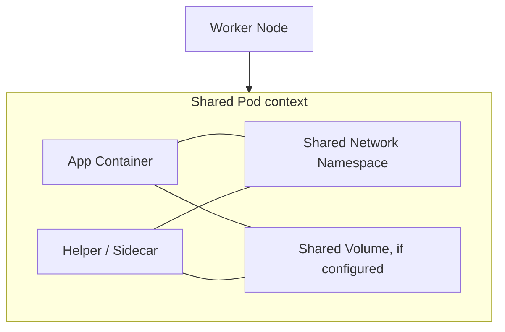
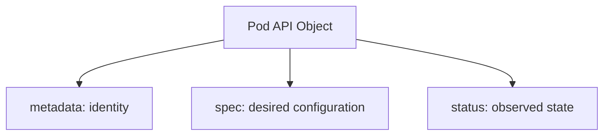
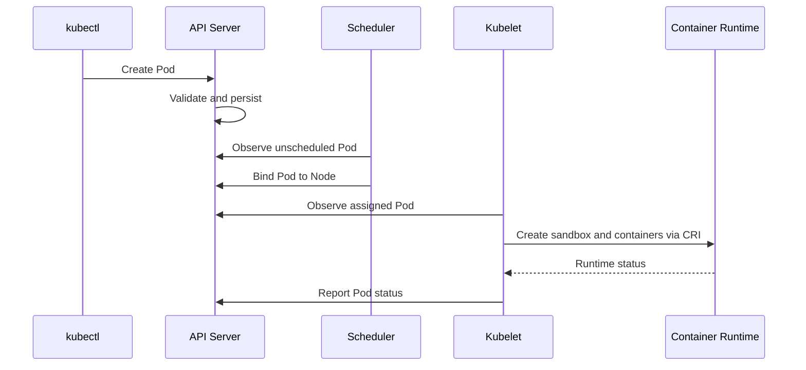
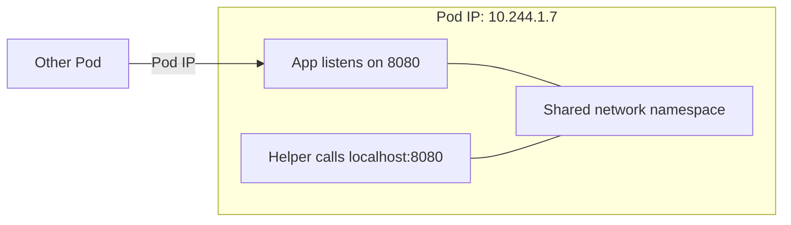
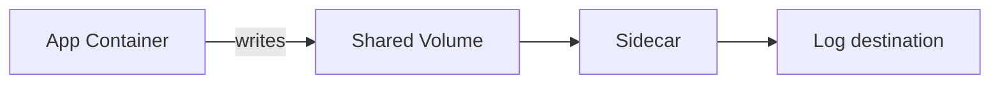

# Chapter 02: Pods

> Pod হলো Kubernetes-এর smallest deployable ও scheduling unit। Container কেন Pod-এর মধ্যে থাকে, Pod কী share করে, এবং তার lifecycle কীভাবে কাজ করে তা বুঝব।

[← Tutorial home](../../README.md) · [Chapter 01: Kubernetes Architecture](../01-kubernetes-architecture/README.md)

## এই অধ্যায়ে কী শিখবে
- Pod কেন container-এর বদলে scheduling unit।
- Pod-এর metadata, spec ও status।
- Pod container-গুলোর shared network ও volume।
- Pod lifecycle, phase ও restart policy।
- Multi-container Pod কখন যুক্তিযুক্ত।
- Pod inspect ও experiment করা।

## 1. Container থাকলে Pod কেন?

Container application ও dependencies-কে packaged runtime environment দেয়। কিন্তু Kubernetes-এ scheduling, placement ও lifecycle-এর জন্য একটি abstraction দরকার, যা এক বা একাধিক tightly coupled container-কে এক unit হিসেবে পরিচালনা করে। এই unit হলো **Pod**।

সাধারণ API application-এর জন্য এক Pod-এ একটি container-ই বেশি প্রচলিত। একাধিক container রাখা হয় যখন তারা একই lifecycle, network identity বা shared storage-এর প্রয়োজন নিয়ে পাশাপাশি কাজ করে।

## 2. Pod-এর mental model

Pod container রাখার বাক্স মাত্র নয়। এটি shared execution context তৈরি করে।

Pod-এর container-গুলো:
- একই Pod IP ও network namespace ভাগ করে।
- localhost দিয়ে একে অপরের port-এ যোগাযোগ করতে পারে।
- Configure করা shared volume mount করতে পারে।
- আলাদা container filesystem ও process isolation বজায় রাখে।

Shared volume না থাকলে container-এর filesystem স্বয়ংক্রিয়ভাবে একে অন্যের কাছে দৃশ্যমান হয় না। একই Pod-এ একই port bind করলেও conflict হবে, কারণ network namespace shared।

## 3. Pod object: metadata, spec, status

| অংশ | ভূমিকা |
|---|---|
| `metadata` | নাম, namespace, label, annotation |
| `spec` | desired configuration: image, command, ports, resources, volumes, restart policy |
| `status` | observed state: phase, IP, conditions, container status |

Pod create request accepted হওয়া মানেই container ready নয়। Pod Pending হতে পারে, image pull fail হতে পারে, process crash করতে পারে বা readiness condition পূরণ নাও হতে পারে।

## 4. Pod তৈরি হলে কী ঘটে?

Chapter 01-এর architecture মনে করো: API Server object গ্রহণ ও persist করে, Scheduler Node নির্বাচন করে, Node-এর kubelet এবং Container Runtime কাজ বাস্তবায়ন করে।

এটি conceptual sequence। Component-গুলো watch/reconciliation loop-এর মাধ্যমে asynchronous কাজ করে; diagram exact internal timeline নয়।

## 5. Networking: Pod-এর container-গুলো কী share করে?

Pod-এর container একই network namespace ভাগ করে। তারা একই Pod IP ব্যবহার করে এবং localhost-এর মাধ্যমে যোগাযোগ করতে পারে।

Pod IP lifecycle-এর সঙ্গে যুক্ত; replacement Pod নতুন IP পেতে পারে। Stable access-এর জন্য সাধারণত Service ব্যবহার করা হয়, যা Chapter 04-এ আসবে।

## 6. Multi-container Pod

Multi-container Pod যুক্তিযুক্ত যখন container-গুলো tightly coupled এবং একই placement/lifecycle/network identity দরকার। একটি common pattern হলো **sidecar**: main application-এর পাশে proxy, log forwarder বা supporting agent চলে।

| Pattern | Purpose | Example |
|---|---|---|
| Sidecar | Main container-এর পাশে supporting behavior | Proxy, log forwarder |
| Ambassador | Outbound communication সহজ/নিয়ন্ত্রিত করা | Local proxy |
| Adapter | Output-কে অন্য system-এর উপযোগী করা | Metrics/log adapter |

এগুলো pattern, বাধ্যতামূলক design নয়। Container আলাদা scale বা deploy করতে হলে আলাদা Pod বেশি উপযুক্ত হতে পারে।

## 7. Pod lifecycle

Pod disposable resource। Pod phase হলো state-এর সংক্ষিপ্ত summary:

| Phase | Meaning |
|---|---|
| Pending | Accepted, কিন্তু scheduling/setup সম্পূর্ণ নয় |
| Running | Node-এ assigned; container running বা starting থাকতে পারে |
| Succeeded | সব container সফলভাবে শেষ |
| Failed | সব container শেষ, অন্তত একটি failure-এ |
| Unknown | State নির্ভরযোগ্যভাবে জানা যাচ্ছে না |

Container state আলাদা:
- **Waiting:** start/setup-এর অপেক্ষা।
- **Running:** process চলছে।
- **Terminated:** process শেষ; reason ও exit code থাকতে পারে।

Container restart এবং Pod replacement এক নয়। Restart হলে একই Pod object/UID থাকতে পারে। Pod delete/replaced হলে নতুন Pod object ও UID হয়।

## 8. Restart policy

Pod-এর `restartPolicy` container exit করলে kubelet-এর behavior নিয়ন্ত্রণ করে:

| Policy | Behavior |
|---|---|
| `Always` | Exit করলে restart করার চেষ্টা |
| `OnFailure` | Non-zero exit হলে restart |
| `Never` | Restart করবে না |

Deployment-এর সাধারণ default `Always`। Restart policy Pod-এর container restart নিয়ন্ত্রণ করে, replacement Pod তৈরি করার controller behavior নয়। Deployment/ReplicaSet replacement তৈরি করতে পারে; standalone Pod-এর জন্য এমন controller থাকে না।

## 9. Resources-এর পরিচিতি

Container-এর CPU ও memory request/limit configure করা যায়।

- **Request:** Scheduler-এর placement ও resource reservation-এর ভিত্তি।
- **Limit:** Runtime constraint; CPU limit throttling করতে পারে, memory limit অতিক্রম করলে OOM kill হতে পারে।

Pod-এর resource calculation এবং scheduling details Chapter 07-এ দেখব।

## 10. Hands-on Lab

[Lab 02: Explore Pod behavior](labs/02-explore-pod.md)

Lab-এ Pod create/inspect, shared localhost network পরীক্ষা, container restart observation, Pod delete/recreate করে UID তুলনা এবং cleanup করবে।

## 11. Common misconceptions
- Pod permanent server নয়; এটি disposable।
- Pod IP স্থায়ী identity নয়।
- Pod create accepted মানেই application ready নয়।
- Container restart ও Pod replacement আলাদা ঘটনা।
- Multi-container Pod সবসময় ভালো design নয়।
- Standalone Pod নিজে desired replica count বজায় রাখে না; Deployment/ReplicaSet এ দায়িত্ব নেয় (Chapter 03)।

## Checkpoint
1. Kubernetes container-এর বদলে Pod schedule করে কেন?
2. Pod-এর container কোন resource share করে?
3. Shared localhost কীভাবে কাজ করে?
4. Pod create accepted হলেই ready কেন নয়?
5. Container restart ও Pod replacement-এর পার্থক্য?
6. Pod IP স্থায়ী ধরে নেওয়া কেন ঠিক নয়?
7. Multi-container Pod কখন যুক্তিযুক্ত?
8. Standalone Pod ও Deployment-managed Pod-এর recovery behavior কীভাবে আলাদা?

## Key Takeaways
- Pod Kubernetes-এর smallest deployable ও scheduling unit।
- Pod container-গুলো shared network namespace এবং optional shared volumes পায়।
- Metadata, spec ও status পৃথক ভূমিকা পালন করে।
- Pod disposable; stable identity/IP ধরে নেওয়া উচিত নয়।
- Restart, replacement এবং workload scaling আলাদা behavior।
- Multi-container Pod tightly coupled helper patterns-এর জন্য।

## Next Chapter
**Chapter 03: Workloads: Deployment ও ReplicaSet**

Pod-এর structure ও lifecycle বোঝার পর দেখব production-এ কেন Deployment/ReplicaSet ব্যবহার করা হয় এবং desired replica count কীভাবে বজায় থাকে।

## Further Reading
- [Kubernetes: Pods](https://kubernetes.io/docs/concepts/workloads/pods/)
- [Kubernetes: Pod Lifecycle](https://kubernetes.io/docs/concepts/workloads/pods/pod-lifecycle/)
- [Kubernetes: Multi-container Pods](https://kubernetes.io/docs/concepts/workloads/pods/)
- [Kubernetes: Container Runtime](https://kubernetes.io/docs/concepts/containers/)
