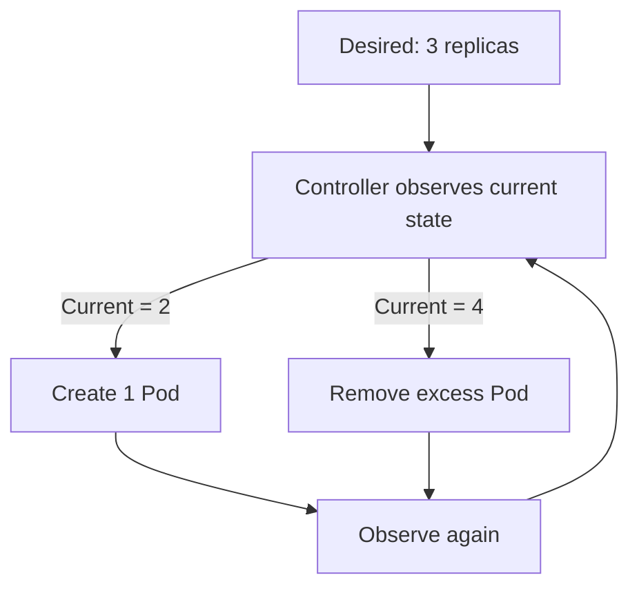
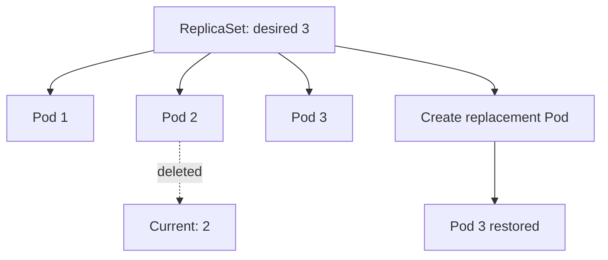
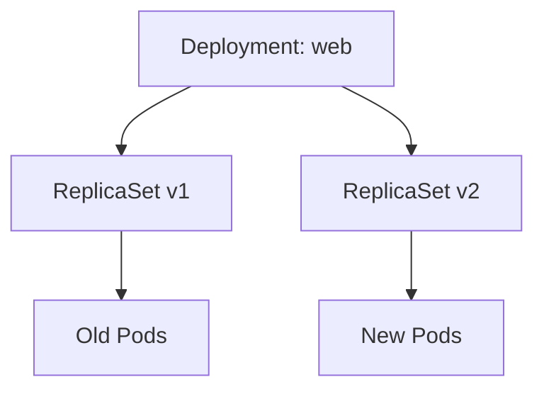
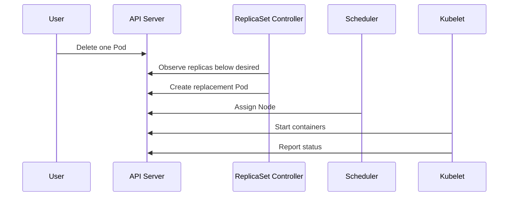
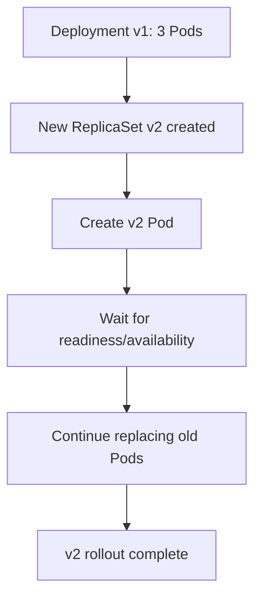

# Chapter 03: Workloads, Deployment ও ReplicaSet

> একটি Pod তৈরি করলেই Kubernetes সেটিকে ধরে রাখে না। Pod মুছে গেলে বা Node হারালে কী হবে? এই chapter-এ শিখব কীভাবে Workload controller desired state বজায় রাখে, এবং কেন সাধারণ application পরিচালনার জন্য Deployment ব্যবহার করা হয়।

[← Tutorial home](../../README.md) · [Chapter 02: Pods](../02-pods/README.md)

## এই অধ্যায়ে কী শিখবে

- Standalone Pod-এর সীমাবদ্ধতা থেকে workload controller কেন দরকার।
- ReplicaSet কীভাবে নির্দিষ্ট replica count বজায় রাখে।
- Deployment ও ReplicaSet-এর সম্পর্ক।
- Desired state, current state এবং reconciliation।
- Scale up/down, self-healing এবং rolling update।
- Deployment rollout observe করা, update ও rollback করা।

## 1. Pod একা যথেষ্ট নয়

Chapter 02-তে আমরা Pod তৈরি করেছি। কিন্তু একটি Pod disposable: Node failure, Pod deletion বা application crash-এর পর standalone Pod সব ক্ষেত্রে নিজেকে replace করে না। Production application-এর জন্য সাধারণত চাই:

- নির্দিষ্ট সংখ্যক replica চালু থাকা।
- Pod হারালে replacement তৈরি হওয়া।
- একই configuration থেকে replica তৈরি করা।
- Version update করার সময় পুরোনো ও নতুন Pod নিয়ন্ত্রিতভাবে বদলানো।
- প্রয়োজন হলে আগের version-এ ফিরে যাওয়া।

এ কাজগুলো workload controller করে। Kubernetes workload resource-এ আমরা desired state ঘোষণা করি; controller observed state দেখে প্রয়োজনীয় পরিবর্তন ঘটায়।

## 2. Workload controller-এর mental model

ধরো, তুমি বলেছ: “আমার web application-এর তিনটি replica থাকা দরকার।”

তুমি তিনটি Pod আলাদা করে তৈরি করে count ধরে রাখবে না। বরং desired replica count ঘোষণা করবে। Controller বারবার বর্তমান অবস্থা দেখে gap পূরণ করবে।



এটি reconciliation-এর simplified model। Controller কোনো একবারের command চালিয়ে শেষ করে না; Kubernetes object-এর state পরিবর্তন ও observation-এর মাধ্যমে system desired state-এর দিকে এগোয়। এটি asynchronous, তাই প্রতিটি ধাপ তাৎক্ষণিক বা একটানা synchronous transaction নয়।

## 3. ReplicaSet: replica count বজায় রাখার দায়িত্ব

**ReplicaSet**-এর মূল দায়িত্ব হলো selector অনুযায়ী নিজের অধীনে থাকা Pod-এর replica সংখ্যা desired count-এর সঙ্গে মিলিয়ে রাখা।

ReplicaSet-এর গুরুত্বপূর্ণ অংশ:

| Field | ভূমিকা |
|---|---|
| `spec.replicas` | কতটি Pod replica desired |
| `spec.selector` | কোন label-যুক্ত Pod শনাক্ত/নিয়ন্ত্রণ করবে |
| `spec.template` | replacement/new Pod তৈরির blueprint |



ReplicaSet-এর selector অবশ্যই Pod template-এর labels-এর সঙ্গে সামঞ্জস্যপূর্ণ হতে হবে। Selector overlap করলে controller-গুলোর মধ্যে ownership conflict হতে পারে। ReplicaSet সাধারণত সরাসরি হাতে manage করার resource নয়; Deployment তার উপরে update management যোগ করে।

### ReplicaSet-এর সীমাবদ্ধতা

ReplicaSet replica count বজায় রাখতে পারে, কিন্তু Pod template বদলে নতুন version-এ controlled rollout, rollout history এবং rollback-এর পূর্ণ workflow দেয় না। সে কারণেই সাধারণ application deployment-এ Deployment ব্যবহার করা হয়।

## 4. Deployment: application rollout-এর উচ্চস্তরের controller

**Deployment** declarative update ও rollout পরিচালনা করে। Deployment-এর Pod template পরিবর্তন হলে সাধারণত নতুন ReplicaSet তৈরি হয়। Deployment নতুন ReplicaSet scale করে এবং পুরোনো ReplicaSet ধীরে ধীরে scale down করে update ঘটায়।



- Deployment: desired application state ও rollout policy।
- ReplicaSet: একটি নির্দিষ্ট Pod template-এর replica count বজায় রাখা।
- Pod: container চালানোর runtime unit।

তুমি Deployment manage করবে। Deployment-owned ReplicaSet বা তার Pod-গুলো সাধারণত সরাসরি edit/delete করে deployment-এর behavior পরিবর্তন করার চেষ্টা করবে না।

## 5. একটি Deployment object পড়ি

```yaml
apiVersion: apps/v1
kind: Deployment
metadata:
  name: web
  labels:
    app: web
spec:
  replicas: 3
  selector:
    matchLabels:
      app: web
  strategy:
    type: RollingUpdate
    rollingUpdate:
      maxSurge: 1
      maxUnavailable: 0
  template:
    metadata:
      labels:
        app: web
    spec:
      containers:
        - name: nginx
          image: nginx:1.27
          ports:
            - containerPort: 80
          resources:
            requests:
              cpu: 50m
              memory: 64Mi
            limits:
              cpu: 200m
              memory: 128Mi
```

| Field | কী বোঝায় |
|---|---|
| `replicas` | Desired Pod সংখ্যা, এখানে 3 |
| `selector` | Deployment কোন Pod-গুলো manage করবে |
| `template` | নতুন Pod-এর blueprint |
| `strategy` | template পরিবর্তন হলে Pod বদলানোর পদ্ধতি |
| `maxSurge` | Update চলাকালে desired count-এর অতিরিক্ত কত Pod তৈরি হতে পারে |
| `maxUnavailable` | Update চলাকালে desired count-এর তুলনায় কত Pod unavailable থাকতে অনুমোদিত |

Selector-এর label অবশ্যই template-এর label-এর সঙ্গে match করতে হবে। এই example-এ `app: web`। Selector mismatch হলে API validation request reject করতে পারে।

## 6. Self-healing: Pod delete করলে কী ঘটে?

Deployment-managed Pod delete করলে সাধারণত ReplicaSet controller desired count-এর তুলনায় কম replica দেখতে পায় এবং replacement Pod তৈরি করে।



Controller replacement Pod তৈরি করতে পারে, কিন্তু application healthy হওয়া নিশ্চিত করে না। Image pull failure, scheduling constraint, resource shortage বা crash loop হলে desired count পূরণের চেষ্টা চললেও ready replica কম থাকতে পারে।

**Self-healing মানে failure অদৃশ্য হয়ে যাওয়া নয়।** Kubernetes replacement চেষ্টা করে; application readiness, dependency, capacity ও failure type recovery-র ফল নির্ধারণ করে।

## 7. Scaling: replica count পরিবর্তন

Deployment-এর `spec.replicas` পরিবর্তন করলে controller replica সংখ্যা বাড়ায় বা কমায়।

```bash
kubectl scale deployment/web --replicas=5
kubectl get deployment web
kubectl get rs -l app=web
kubectl get pods -l app=web -o wide
```

Scale up-এ নতুন Pod তৈরি ও schedule হবে। Scale down-এ অতিরিক্ত Pod terminate হবে। Replica count হলো desired state, তাৎক্ষণিক current count নয়।

Scaling application-এর capacity বাড়াতে পারে, কিন্তু প্রতিটি replica-র জন্য resource লাগবে। Node-এ পর্যাপ্ত capacity না থাকলে Pod Pending থাকতে পারে। Infrastructure autoscaling আলাদা mechanism; replica বাড়ানো মানেই Node/EC2 বাড়ানো নয়।

## 8. Rolling update: নতুন version ধীরে চালু করা

Deployment-এর Pod template, যেমন container image পরিবর্তন করলে Deployment নতুন ReplicaSet তৈরি করে rollout শুরু করে।



RollingUpdate strategy-তে:
- `maxSurge`: update চলাকালে desired replicas-এর উপরে কত অতিরিক্ত Pod অনুমোদিত।
- `maxUnavailable`: update চলাকালে desired count-এর কত Pod unavailable থাকতে পারে।

এগুলো rollout-এর concurrency ও capacity trade-off। `maxUnavailable: 0` এবং `maxSurge: 1` হলে Deployment নতুন Pod তৈরি করার সুযোগ রাখে এবং unavailable replica কমাতে চায় না; তবে নতুন Pod readiness-এ না পৌঁছালে rollout আটকে থাকতে পারে, এবং cluster capacity দরকার হবে।

Rollout observe করো:

```bash
kubectl rollout status deployment/web
kubectl rollout history deployment/web
kubectl get deployment,rs,pods -l app=web
```

Rolling update downtime-এর guarantee নয়। Application readiness ঠিকভাবে configured না থাকলে, incompatible application changes বা external dependency failure থাকলে traffic disruption হতে পারে। Readiness probe ও health behavior Chapter 08-এ গভীরভাবে আসবে।

## 9. Rollback: আগের revision-এ ফিরে যাওয়া

Deployment rollout history সংরক্ষণ করে। কোনো নতুন revision সমস্যাযুক্ত হলে আগের revision-এ ফিরে যেতে পারো:

```bash
kubectl rollout undo deployment/web
kubectl rollout status deployment/web
kubectl rollout history deployment/web
```

Rollback Deployment-এর Pod template-কে আগের revision-এ ফিরিয়ে দেয়; controller আবার reconcile করে। এটি database migration বা external side effect স্বয়ংক্রিয়ভাবে reverse করে না। Rollback করলেই সব application-level change নিরাপদে উল্টে যাবে, এমন নয়।

## 10. Deployment-এর status বুঝে নেওয়া

```bash
kubectl get deployment web
kubectl describe deployment web
kubectl get rs -l app=web
kubectl get pods -l app=web
kubectl rollout status deployment/web
kubectl rollout history deployment/web
```

Deployment output-এ `READY`, `UP-TO-DATE`, `AVAILABLE` দেখতে পারো। এগুলো desired replicas, updated Pod এবং availability-র বিভিন্ন দিক প্রকাশ করে। শুধু `Running` Pod count দেখেই rollout সফল বলা ঠিক নয়।

কোনো rollout আটকে গেলে:

- Deployment ও ReplicaSet status/conditions inspect করো।
- Pod events দেখো: `kubectl describe pod <pod-name>`।
- Container log দেখো: `kubectl logs <pod-name>`।
- Pod Pending হলে scheduling/resources/image pull issue খুঁজে দেখো।
- Pod Running কিন্তু unavailable হলে readiness/availability condition দেখো।

Troubleshooting chapter-এ এই পদ্ধতি systematic ভাবে অনুশীলন করব।

## 11. ReplicaSet বনাম Deployment

| বিষয় | ReplicaSet | Deployment |
|---|---|---|
| Replica count বজায় রাখা | হ্যাঁ | ReplicaSet-এর মাধ্যমে |
| Pod template থেকে Pod তৈরি | হ্যাঁ | ReplicaSet-এর মাধ্যমে |
| Rolling update orchestration | নিজে পূর্ণ workflow নয় | হ্যাঁ |
| Revision/history | সীমিত | Deployment rollout history |
| Rollback workflow | নেই | আছে |
| সাধারণ application deploy-এর উপযোগী | সাধারণত সরাসরি নয় | হ্যাঁ |

ReplicaSet-এর behavior বুঝতে এটি গুরুত্বপূর্ণ, কিন্তু সাধারণ application deploy/update-এর জন্য Deployment-ই preferred abstraction।

## 12. Hands-on Lab

[Lab 03: Deploy, scale, self-heal and rollout](labs/03-deployment-replicaset.md)

Lab-এ Deployment create, ReplicaSet/Pod hierarchy observe, Pod delete করে replacement দেখা, replica scale, image update, rollout history/undo এবং cleanup করবে।

## 13. Common misconceptions

- Deployment সরাসরি container চালায় না; ReplicaSet এবং Pod-এর মাধ্যমে কাজ হয়।
- ReplicaSet replica count বজায় রাখে, কিন্তু Deployment-এর rollout/history/rollback workflow দেয় না।
- Pod delete হলে replacement Pod-এর নাম, UID বা IP আগের মতো থাকবে না।
- Desired replicas 3 মানেই সবসময় 3টি Ready Pod আছে, এমন নয়।
- Pod Running মানেই application traffic serve করার উপযুক্ত, এমন নয়।
- Rolling update নিজে থেকেই zero downtime guarantee করে না।
- Scale up মানেই Node বা EC2 instance বাড়ানো নয়।
- Deployment-owned ReplicaSet সরাসরি edit করা উচিত নয়।

## Checkpoint

1. Standalone Pod delete হলে কেন replacement নিশ্চিত নয়, কিন্তু Deployment-managed Pod হলে সাধারণত replacement হয়?
2. ReplicaSet-এর তিনটি মূল input/field কী?
3. Deployment কেন ReplicaSet তৈরি করে?
4. Pod template পরিবর্তন হলে কীভাবে নতুন revision/ReplicaSet তৈরি হতে পারে?
5. `replicas: 3` desired state, current state নয় কেন?
6. `maxSurge` ও `maxUnavailable` rollout-এর কোন trade-off নিয়ন্ত্রণ করে?
7. নতুন Pod Ready না হলে rollout কীভাবে প্রভাবিত হতে পারে?
8. Rollback কী reverse করে, আর কী reverse করে না?
9. 5 replica চাইলেও Pod Pending থাকতে পারে কেন?
10. Deployment, ReplicaSet ও Pod-এর responsibility একসঙ্গে ব্যাখ্যা করো।

## Key Takeaways

- Workload controller Pod-এর desired state বজায় রাখতে সাহায্য করে।
- ReplicaSet selector ও Pod template ব্যবহার করে replica count reconcile করে।
- Deployment ReplicaSet পরিচালনা করে এবং declarative rollout, revision ও rollback workflow দেয়।
- Pod deletion-এর পর replacement তৈরি হতে পারে, কিন্তু readiness ও application health আলাদা করে যাচাই করতে হয়।
- Scaling এবং rolling update capacity, readiness ও availability-র trade-off তৈরি করে।
- Kubernetes recovery চেষ্টা করে; application-level correctness, dependency ও data safety নিজে guarantee করে না।

## Next Chapter

**[Chapter 04: Kubernetes Networking](../04-kubernetes-networking/README.md)**

এখন একাধিক Pod চালানো ও update করা শিখেছি। কিন্তু Pod-এর IP disposable এবং replica বদলাতে পারে। পরবর্তী chapter-এ Service কীভাবে পরিবর্তনশীল Pod-এর সামনে stable network endpoint তৈরি করে তা দেখব।

## Further Reading

- [Kubernetes: Deployments](https://kubernetes.io/docs/concepts/workloads/controllers/deployment/)
- [Kubernetes: ReplicaSet](https://kubernetes.io/docs/concepts/workloads/controllers/replicaset/)
- [Kubernetes: Deployments rollout](https://kubernetes.io/docs/concepts/workloads/controllers/deployment/#updating-a-deployment)
- [Kubernetes: Deployment rollback](https://kubernetes.io/docs/concepts/workloads/controllers/deployment/#rolling-back-a-deployment)
